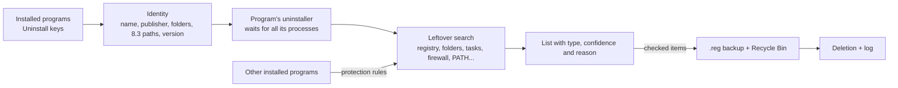

<div align="center">


# EXTIRPA

The **EX**haustive **T**race & **I**nstalled-**R**esidue **P**urge **A**gent (**E.X.T.I.R.P.A.**) is a complete uninstaller for Windows. It runs a program's own uninstaller and then hunts down everything the program left behind: folders, files, registry keys and values, services, scheduled tasks, firewall rules, startup entries, shortcuts, context menu entries, file types and PATH entries. Written from scratch in C, with no runtime and no C library: one executable of about 240 KB.

**English** · [Português (Brasil)](docs/i18n/README.pt-BR.md) · [Español](docs/i18n/README.es-ES.md) · [Français](docs/i18n/README.fr-FR.md) · [中文](docs/i18n/README.zh-CN.md) · [हिन्दी](docs/i18n/README.hi-IN.md) · [العربية](docs/i18n/README.ar.md) · [বাংলা](docs/i18n/README.bn-BD.md)

   

</div>

---

## Why EXTIRPA

Uninstallers that come with programs usually remove the program's files and stop there. Settings in the registry, folders in AppData, the scheduled task that checked for updates, the firewall rule, the context menu entry, the folder added to PATH: all of it stays behind, and piles up program after program.

EXTIRPA removes the program the right way first, with the program's own uninstaller, and then looks for the leftovers. Its goals:

- **Thorough:** it looks in every place a program usually writes to, from AppData to scheduled tasks and firewall rules (the full list is below).
- **Safe:** it never touches what belongs to Windows or to another installed program, backs up the registry before deleting, and sends files to the Recycle Bin.
- **Transparent:** every item comes with its type, a confidence level and the reason it was found. Only high-confidence items come checked.
- **Light:** one native executable of about 240 KB, no installer, no services, no telemetry. It does its job and closes.
- **Open source:** the code is fully auditable, and you can build your own version and change whatever you want.

## Why the name

To **extirpate** (Portuguese *extirpar*) is to pull something out by the roots, so that nothing grows back. That is what EXTIRPA does with a program: it does not just remove what shows, it goes after the roots the program spread around the system.

The name is also an acronym:

- **EX**haustive: every place a program can leave something is searched, not only the install folder.
- **T**race: it follows the program's traces, the paths and names it wrote into the registry, tasks, shortcuts and settings, and it can also trace an installation as it happens.
- **I**nstalled-**R**esidue: what it is after is what the installation left behind once the uninstaller is done.
- **P**urge **A**gent: it removes those residues, with a backup of the registry and through the Recycle Bin.

Put the initials together: **E.X.T.I.R.P.A.**

## Features

- **Uninstall:** runs the program's uninstaller and waits for it and every process it starts to finish (job object), then searches for leftovers.
- **Three search modes:** Safe (exact names and the install folder), Moderate (also startup entries, services, shortcuts, scheduled tasks, firewall rules, file types and everything that points to the program's folder; recommended), Advanced (also similar names and a deep scan of the registry for any value that points to the program).
- **Where it looks:** the install folder; Program Files, ProgramData, AppData (Roaming, Local, LocalLow) and the publisher's folders; registry keys under SOFTWARE (64 and 32 bits, machine and user); Run, RunOnce and the Task Manager's startup switches; services; scheduled tasks; Windows Firewall rules; the PATH variable (system and user); App Paths and SharedDLLs; file types (ProgIDs), "Open with" lists and default associations; COM components and type libraries; context menu entries and Explorer extensions (handlers, icon overlays, approved extensions); Software\Clients and RegisteredApplications; shortcuts on the desktop, Start menu, Startup folder and taskbar pins; usage traces Windows keeps per program (MuiCache, compatibility settings). Paths written in short 8.3 form (`C:\PROGRA~1\...`) are recognized too.
- **Quick and batch uninstall:** select several programs and uninstall them in a row. When the uninstaller supports it, it runs silently: Windows Installer (MSI), Inno Setup and NSIS are recognized automatically, besides the `QuietUninstallString` some programs register.
- **Forced uninstall:** removes the leftovers of a program that is already gone, broken or has no uninstaller. Give its name, its folder or both.
- **Install tracing:** takes a snapshot of the registry and folders, runs the installer, takes another snapshot and saves what the installation created. Later, "Uninstall using trace" removes exactly that.
- **Hunter mode:** the window turns into a crosshair in the corner of the screen. Drop it on any program's window to uninstall it, open its folder, end it or stop it from starting with Windows.
- **Windows apps:** lists Microsoft Store and built-in apps and removes them for the current user or for all users.
- **Startup manager:** enable, disable (the same switch as the Task Manager) or delete what starts with Windows, from the registry and the Startup folders.
- **Backups:** every registry deletion is preceded by a `.reg` file that restores everything with a double-click (or from the Backups tab), files go to the Recycle Bin, removed scheduled tasks are saved as `.xml`, and a Windows restore point can be created before each uninstall.
- **Everything logged:** every deletion, failure and backup goes to `%LOCALAPPDATA%\EXTIRPA\extirpa.log`.
- **Interface in Portuguese (Brazil) and English**, following the Windows display language, and sharp at any scaling (per-monitor DPI).

## Getting started

1. Download `extirpa.exe` from the [latest release](https://github.com/MatheusRFC/extirpa/releases/latest) and save it anywhere, for example `C:\Tools`. There is nothing to install.
2. Run it. Windows asks for administrator rights (needed to remove programs installed for all users) and SmartScreen warns because the program is not code-signed: choose **More info → Run anyway**.
3. Pick a program and click **Uninstall**. Choose the search mode, confirm, and follow the program's own uninstaller.
4. When it finishes, EXTIRPA shows the leftovers it found. Review the list, uncheck anything you want to keep and click **Delete checked**.

EXTIRPA does not start with Windows, has no background service and leaves nothing running: close it and it is gone. Its data (backups, traces, log and settings) lives in `%LOCALAPPDATA%\EXTIRPA`.

### Keyboard

| Key | Action |
|---|---|
| `Ctrl+F` | Search the current list |
| `F5` | Refresh |
| `Delete` / double-click | Uninstall the selected program |
| `Esc` | Clear the search |

## How it works



1. Before uninstalling, EXTIRPA reads everything that identifies the program: its name without version and architecture, the publisher, its folders (also in short 8.3 form) and the names of its executables. After the uninstaller runs, the program's entry is gone, so this has to happen first.
2. It runs the uninstaller and waits for it and every process it starts.
3. It searches for leftovers. Every item gets a confidence level: **high** (exact name, the program's own folder or something that points into it; comes checked), **medium** (similar name, indirect reference; unchecked) or **low** (ambiguous; unchecked).
4. It deletes only what you leave checked: registry backup first, then services and scheduled tasks, firewall rules and PATH, registry, and finally files through the Recycle Bin. Folders that are in use can be scheduled for deletion at the next restart.

## Safety

Removing too much is worse than removing too little, so EXTIRPA is built around rules that protect the rest of the system:

- **Protection list:** system folders (Windows, Program Files itself, user folders, AppData itself, Start menu...) and the registry areas that belong to Windows (`HKLM\SYSTEM`, Windows Installer data, policies, the roots of file types and COM...) are never deleted, nor is any folder or key that contains them. The protection is checked when an item enters the list and again right before deletion.
- **The most specific folder wins:** a path inside `C:\Program Files\Vendor\Other` belongs to the program installed there, not to one installed in `C:\Program Files\Vendor`.
- **Names shared with another installed program** (two versions of Python share "Python", for example) come unchecked, and EXTIRPA looks inside them for the part that belongs only to the program being removed.
- **Folders that contain another installed program** are removed item by item, keeping the other program.
- **Windows' own scheduled tasks** (`\Microsoft\...`) are never touched.

More in [SECURITY.md](SECURITY.md).

## Building from source

EXTIRPA needs only LLVM (clang, lld-link, llvm-rc and llvm-dlltool), on Windows or Linux. No Windows SDK, MinGW or C library: the Windows declarations it uses are in `src/win/win32.h`, written by hand and checked against the official mingw-w64 headers by `tools/check_win32.py`.

```bash
python3 tools/build.py test      # tests: the core, plus the Windows part on a simulated registry and disk
python3 tools/build.py           # build/extirpa.exe
python3 tools/build.py all       # tests, extirpa.exe and extirpa-selftest.exe
python3 scripts/package.py       # release files in dist/
```

`extirpa-selftest.exe --selftest` runs a self-test on a real Windows and saves a report and screenshots to `%LOCALAPPDATA%\EXTIRPA\selftest`. Icons: `python3 tools/gerar_icones.py` (needs Pillow); the master drawing is `assets/extirpa.svg`.

## Project history

See [CHANGELOG.md](CHANGELOG.md). EXTIRPA started in October 2026 as a personal project, the fifth after RAJADA, VISOR, ELMO and MIRA, to have an uninstaller of my own instead of depending on third-party licenses.

## License

EXTIRPA is free software under the [MIT License](LICENSE).
