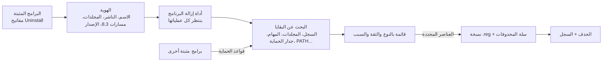

<div align="center" dir="rtl">


# EXTIRPA

‏**EX**haustive **T**race & **I**nstalled-**R**esidue **P**urge **A**gent ‏(**E.X.T.I.R.P.A.**) هو أداة إزالة كاملة للبرامج على Windows. يشغّل أداة الإزالة الخاصة بالبرنامج نفسه، ثم يتعقّب كل ما تركه البرنامج خلفه: المجلدات والملفات ومفاتيح السجل وقيمه والخدمات والمهام المجدولة وقواعد جدار الحماية وعناصر بدء التشغيل والاختصارات وعناصر قائمة السياق وأنواع الملفات وإدخالات PATH. مكتوب من الصفر بلغة C، بلا بيئة تشغيل وبلا مكتبة C: ملف تنفيذي واحد بحجم 270 كيلوبايت تقريبًا.

[English](../../README.md) · [Português (Brasil)](README.pt-BR.md) · [Español](README.es-ES.md) · [Français](README.fr-FR.md) · [中文](README.zh-CN.md) · [हिन्दी](README.hi-IN.md) · **العربية** · [বাংলা](README.bn-BD.md)

   

</div>

<div dir="rtl">

---

## لماذا EXTIRPA

أداة الإزالة المرفقة مع كل برنامج تحذف ملفاته في العادة ثم تتوقف. إعدادات في السجل، ومجلدات في AppData، والمهمة المجدولة التي كانت تبحث عن التحديثات، وقاعدة جدار الحماية، وعنصر قائمة السياق، والمجلد المضاف إلى PATH: كل ذلك يبقى ويتراكم برنامجًا بعد برنامج.

يزيل EXTIRPA البرنامج أولًا بالطريقة الصحيحة، بأداة الإزالة الخاصة به، ثم يبحث عن البقايا. أهدافه:

- **شامل:** يبحث في كل مكان يكتب فيه البرنامج عادةً، من AppData إلى المهام المجدولة وقواعد جدار الحماية (القائمة الكاملة أدناه).
- **آمن:** لا يلمس أبدًا ما يخص Windows أو أي برنامج مثبّت آخر، ويأخذ نسخة احتياطية من السجل قبل الحذف، ويرسل الملفات إلى سلة المحذوفات.
- **واضح:** يظهر لكل عنصر نوعه ومستوى الثقة وسبب العثور عليه. العناصر عالية الثقة فقط تأتي محددة.
- **خفيف:** ملف تنفيذي أصلي بحجم 270 كيلوبايت تقريبًا، بلا تثبيت ولا خدمات ولا قياس عن بُعد. يؤدي مهمته ثم يُغلق.
- **مفتوح المصدر:** الشيفرة قابلة للتدقيق بالكامل، ويمكنك بناء نسختك الخاصة وتغيير ما تشاء.

## سبب الاسم

‏**Extirpar** (بالبرتغالية: الاستئصال) يعني اقتلاع الشيء من جذوره حتى لا ينمو مجددًا. هذا ما يفعله EXTIRPA بالبرنامج: لا يزيل ما يظهر فقط، بل يلاحق الجذور التي نشرها البرنامج في النظام.

الاسم أيضًا اختصار:

- ‏**EX**haustive (شامل): يبحث في كل مكان قد يترك فيه البرنامج شيئًا، لا في مجلد التثبيت فقط.
- ‏**T**race (أثر): يتتبع آثار البرنامج، أي المسارات والأسماء التي كتبها في السجل والمهام والاختصارات والإعدادات، ويمكنه أيضًا تتبّع عملية تثبيت أثناء حدوثها.
- ‏**I**nstalled-**R**esidue (بقايا التثبيت): هدفه ما تركه التثبيت بعد انتهاء أداة الإزالة.
- ‏**P**urge **A**gent (وكيل الإزالة): يزيل هذه البقايا، مع نسخة احتياطية من السجل وعبر سلة المحذوفات.

اجمع الحروف الأولى: **E.X.T.I.R.P.A.**

## الميزات

- **الإزالة:** يشغّل أداة إزالة البرنامج وينتظر انتهاءها مع كل العمليات التي تبدأها (job object)، ثم يبحث عن البقايا.
- **ثلاثة أوضاع للبحث:** آمن (الأسماء المطابقة ومجلد التثبيت)، معتدل (أيضًا عناصر بدء التشغيل والخدمات والاختصارات والمهام المجدولة وقواعد جدار الحماية وأنواع الملفات وكل ما يشير إلى مجلد البرنامج؛ موصى به)، متقدم (أيضًا الأسماء المشابهة وفحص عميق للسجل بحثًا عن أي قيمة تشير إلى البرنامج).
- **أين يبحث:** مجلد التثبيت (ومجلد الناشر الذي يحتويه إذا أصبح فارغًا)؛ Program Files وProgramData وAppData ‏(Roaming وLocal وLocalLow) ومجلدات الناشر؛ مفاتيح السجل تحت SOFTWARE ‏(64 و32 بت، الجهاز والمستخدم)؛ Run وRunOnce ومفاتيح بدء التشغيل في إدارة المهام؛ الخدمات؛ المهام المجدولة؛ قواعد جدار حماية Windows؛ متغير PATH ‏(النظام والمستخدم)؛ App Paths وSharedDLLs؛ أنواع الملفات (ProgID) وقوائم "فتح باستخدام" والارتباطات الافتراضية؛ مكونات COM ومكتبات الأنواع؛ عناصر قائمة السياق وإضافات المستكشف (المعالجات، تراكبات الأيقونات، الإضافات المعتمدة)؛ معالجات التشغيل التلقائي (AutoPlay)؛ حزم Windows التي سجلها البرنامج (مثل حزمة قائمة السياق في Windows 11)؛ Software\Clients وRegisteredApplications؛ الاختصارات على سطح المكتب وفي قائمة ابدأ ومجلد بدء التشغيل والمثبتة على شريط المهام؛ آثار الاستخدام التي يحفظها Windows لكل برنامج (MuiCache، إعدادات التوافق، UserAssist، قوائم الانتقال، قائمة الاختصارات المستخدمة في قائمة ابدأ). كما يتعرف على المسارات المكتوبة بالصيغة القصيرة 8.3 ‏(`C:\PROGRA~1\...`). بالنسبة لبرامج Windows Installer ‏(MSI) التي لا تسجّل مجلد تثبيتها، يعثر عليه EXTIRPA من سجلات مكونات المثبّت وApp Paths واختصارات قائمة ابدأ. ويجد أيضًا ما يحفظه Windows باسم الملف التنفيذي للبرنامج (ملفات Prefetch، وتفريغات الأعطال، وتقارير الأخطاء، ومفاتيح تتبّع الشبكة) وما يحفظه Windows Installer لبرنامج MSI (تسجيله، والحزمة المخزّنة مؤقتًا، والمجلدات المسجّلة).
- **إزالة سريعة ودفعية:** حدّد عدة برامج وأزلها واحدًا تلو الآخر. عندما تسمح أداة الإزالة، تعمل بصمت: يتعرف تلقائيًا على Windows Installer ‏(MSI) وInno Setup وNSIS، إضافة إلى `QuietUninstallString` الذي تسجله بعض البرامج.
- **الإزالة القسرية:** تزيل بقايا برنامج سبق حذفه أو تعطل أو بلا أداة إزالة. أدخل اسمه أو مجلده أو كليهما.
- **تتبّع التثبيت:** يلتقط صورة للسجل والمجلدات، ويشغّل المثبّت، ثم يلتقط صورة أخرى ويحفظ ما أنشأه التثبيت. لاحقًا يزيل "Uninstall using trace" هذا بالضبط.
- **وضع الصياد:** تتحول النافذة إلى علامة تصويب في زاوية الشاشة. أسقطها على نافذة أي برنامج لإزالته أو فتح مجلده أو إنهائه أو منعه من البدء مع Windows.
- **تطبيقات Windows:** يعرض تطبيقات Microsoft Store والتطبيقات المضمنة في Windows ويزيلها للمستخدم الحالي أو لجميع المستخدمين.
- **مدير بدء التشغيل:** يفعّل أو يعطّل (المفتاح نفسه في إدارة المهام) أو يحذف ما يبدأ مع Windows، في السجل ومجلدات بدء التشغيل.
- **النسخ الاحتياطية:** قبل كل حذف من السجل يُنشأ ملف `.reg` يستعيد كل شيء بنقرة مزدوجة (أو من تبويب Backups)، وتذهب الملفات إلى سلة المحذوفات، وتُحفظ المهام المجدولة المحذوفة بصيغة `.xml`، ويمكن إنشاء نقطة استعادة لـWindows قبل كل إزالة.
- **كل شيء مسجّل:** كل حذف وكل فشل وكل نسخة احتياطية يُكتب في `%LOCALAPPDATA%\EXTIRPA\extirpa.log`.
- **الواجهة بالبرتغالية (البرازيل) والإنجليزية** (بالإنجليزية للغات Windows الأخرى)، وواضحة في أي مقياس عرض (DPI لكل شاشة).

## البدء

1. نزّل `extirpa.exe` من [أحدث إصدار](https://github.com/MatheusRFC/extirpa/releases/latest) واحفظه في أي مكان، مثل `C:\Tools`. لا يوجد ما يُثبَّت.
2. شغّله. يطلب Windows صلاحيات المسؤول (لازمة لإزالة البرامج المثبتة لجميع المستخدمين)، وينبّه SmartScreen لأن البرنامج غير موقّع رقميًا: اختر **مزيد من المعلومات ← التشغيل على أي حال**.
3. اختر برنامجًا وانقر **Uninstall**. اختر وضع البحث وأكّد، ثم اتبع أداة الإزالة الخاصة بالبرنامج.
4. في النهاية يعرض EXTIRPA البقايا على خطوتين: أولًا عناصر السجل والنظام (المفاتيح، والقيم، والخدمات، والمهام المجدولة، وقواعد جدار الحماية، وPATH)، ثم الملفات والمجلدات. في كل خطوة راجع القائمة، وألغِ تحديد ما تريد الاحتفاظ به، ثم انقر **Delete checked** وبعدها **Next**.

لا يبدأ EXTIRPA مع Windows، ولا يملك خدمة في الخلفية، ولا يترك شيئًا قيد التشغيل: بمجرد إغلاقه ينتهي كل شيء. بياناته (النسخ الاحتياطية والتتبعات والسجل والإعدادات) موجودة في `%LOCALAPPDATA%\EXTIRPA`.

### لوحة المفاتيح

| المفتاح | الإجراء |
|---|---|
| `Ctrl+F` | البحث في القائمة الحالية |
| `F5` | تحديث |
| `Delete` / نقرة مزدوجة | إزالة البرنامج المحدد |
| `Esc` | مسح البحث |

## كيف يعمل



1. قبل الإزالة يقرأ EXTIRPA كل ما يعرّف البرنامج: اسمه دون الإصدار والمعمارية، والناشر، ومجلداته (بالصيغة القصيرة 8.3 أيضًا)، وأسماء ملفاته التنفيذية. بعد تشغيل أداة الإزالة يختفي إدخال البرنامج، لذا يجب أن يحدث هذا أولًا.
2. يشغّل أداة الإزالة وينتظرها مع كل العمليات التي تبدأها. وقبل ذلك مباشرة يحلّل البرنامج وهو لا يزال مثبتًا: ما يجده هذا التحليل ويتركه برنامج الإزالة يُعدّ أيضًا من البقايا.
3. يبحث عن البقايا. يحصل كل عنصر على مستوى ثقة: **عالٍ** (اسم مطابق، أو مجلد البرنامج نفسه، أو شيء يشير إلى داخله؛ يأتي محددًا)، أو **متوسط** (اسم مشابه، مرجع غير مباشر؛ غير محدد)، أو **منخفض** (غامض؛ غير محدد).
4. يحذف فقط ما تتركه محددًا: أولًا النسخة الاحتياطية للسجل، ثم الخدمات والمهام المجدولة، وقواعد جدار الحماية وPATH، والسجل، وأخيرًا الملفات عبر سلة المحذوفات. يمكن جدولة المجلدات قيد الاستخدام لحذفها عند إعادة التشغيل التالية.

## الأمان

حذف الكثير أسوأ من حذف القليل، لذلك بُني EXTIRPA حول قواعد تحمي بقية النظام:

- **قائمة الحماية:** مجلدات النظام (Windows، وProgram Files نفسه، ومجلدات المستخدم، وAppData نفسه، وقائمة ابدأ...) ومناطق السجل التابعة لـWindows ‏(`HKLM\SYSTEM`، وبيانات Windows Installer، والسياسات، وجذور أنواع الملفات وCOM...) لا تُحذف أبدًا، ولا أي مجلد أو مفتاح يحتويها. تُفحص الحماية عند دخول العنصر إلى القائمة، ومرة أخرى قبل الحذف مباشرة. الاستثناءات الوحيدة هي عناصر البرنامج نفسه، المحددة بدقة: تسجيله في Windows Installer (برمز المنتج)، وحزمة المثبّت المخزّنة مؤقتًا، وملفات Prefetch الخاصة به.
- **المجلد الأكثر تحديدًا يفوز:** المسار داخل `C:\Program Files\Vendor\Other` يخص البرنامج المثبت هناك، لا البرنامج المثبت في `C:\Program Files\Vendor`.
- **الأسماء المشتركة مع برنامج مثبت آخر** (مثل إصدارين من Python يشتركان في "Python") تأتي غير محددة، ويبحث EXTIRPA داخلها عن الجزء الخاص بالبرنامج المراد إزالته فقط.
- **المجلدات التي تحتوي برنامجًا مثبتًا آخر** تُزال عنصرًا عنصرًا، مع الإبقاء على البرنامج الآخر.
- **المهام المجدولة الخاصة بـWindows** ‏(`\Microsoft\...`) لا تُلمس أبدًا.

المزيد في [SECURITY.md](../../SECURITY.md).

## البناء من المصدر

لا يحتاج EXTIRPA إلا إلى LLVM ‏(clang وlld-link وllvm-rc وllvm-dlltool)، على Windows أو Linux. لا حاجة إلى Windows SDK أو MinGW أو مكتبة C: تعريفات Windows التي يستخدمها موجودة في `src/win/win32.h`، مكتوبة يدويًا ومُتحقق منها مقابل الترويسات الرسمية لـmingw-w64 بواسطة `tools/check_win32.py`.

```bash
python3 tools/build.py test      # الاختبارات: النواة، وجزء Windows على سجل وقرص محاكيين
python3 tools/build.py           # build/extirpa.exe
python3 tools/build.py all       # الاختبارات وextirpa.exe وextirpa-selftest.exe
python3 scripts/package.py       # ملفات الإصدار في dist/
```

يشغّل `extirpa-selftest.exe --selftest` اختبارًا ذاتيًا على Windows حقيقي ويحفظ تقريرًا ولقطات شاشة في `%LOCALAPPDATA%\EXTIRPA\selftest`. الأيقونات: `python3 tools/gerar_icones.py` (يتطلب Pillow)؛ الرسم الأصلي هو `assets/extirpa.svg`.

## تاريخ المشروع

راجع [CHANGELOG.md](../../CHANGELOG.md). بدأ EXTIRPA في أكتوبر 2026 كمشروع شخصي، الخامس بعد RAJADA وVISOR وELMO وMIRA، للحصول على أداة إزالة خاصة بدل الاعتماد على تراخيص جهات أخرى.

## الترخيص

EXTIRPA برنامج حر بموجب [ترخيص MIT](../../LICENSE).

</div>
