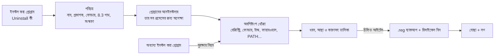

<div align="center">


# EXTIRPA

**EX**haustive **T**race & **I**nstalled-**R**esidue **P**urge **A**gent (**E.X.T.I.R.P.A.**) হলো Windows-এর জন্য একটি সম্পূর্ণ আনইনস্টলার। এটি প্রথমে প্রোগ্রামের নিজস্ব আনইনস্টলার চালায়, তারপর প্রোগ্রামটি যা কিছু রেখে গেছে সব খুঁজে বের করে: ফোল্ডার, ফাইল, রেজিস্ট্রির কী ও ভ্যালু, সার্ভিস, শিডিউলড টাস্ক, ফায়ারওয়ালের নিয়ম, স্টার্টআপ আইটেম, শর্টকাট, কনটেক্সট মেনুর আইটেম, ফাইল টাইপ এবং PATH-এর এন্ট্রি। শূন্য থেকে C-তে লেখা, কোনো রানটাইম বা C লাইব্রেরি ছাড়া: প্রায় 240 KB-এর একটিমাত্র এক্সিকিউটেবল।

[English](../../README.md) · [Português (Brasil)](README.pt-BR.md) · [Español](README.es-ES.md) · [Français](README.fr-FR.md) · [中文](README.zh-CN.md) · [हिन्दी](README.hi-IN.md) · [العربية](README.ar.md) · **বাংলা**

   

</div>

---

## কেন EXTIRPA

প্রতিটি প্রোগ্রামের সঙ্গে আসা আনইনস্টলার সাধারণত নিজের ফাইলগুলো মুছে থেমে যায়। রেজিস্ট্রির সেটিংস, AppData-র ফোল্ডার, আপডেট খোঁজার শিডিউলড টাস্ক, ফায়ারওয়ালের নিয়ম, কনটেক্সট মেনুর আইটেম, PATH-এ যোগ করা ফোল্ডার: এসব থেকে যায়, আর একটার পর একটা প্রোগ্রামে জমতে থাকে।

EXTIRPA প্রথমে প্রোগ্রামটিকে সঠিক উপায়ে, তার নিজস্ব আনইনস্টলার দিয়ে সরায়, তারপর অবশিষ্টাংশ খোঁজে। এর লক্ষ্য:

- **পূর্ণাঙ্গ:** একটি প্রোগ্রাম সাধারণত যেখানে যেখানে লেখে, সব জায়গায় খোঁজে, AppData থেকে শিডিউলড টাস্ক ও ফায়ারওয়ালের নিয়ম পর্যন্ত (সম্পূর্ণ তালিকা নিচে)।
- **নিরাপদ:** Windows বা অন্য কোনো ইনস্টল করা প্রোগ্রামের জিনিসে কখনো হাত দেয় না, মোছার আগে রেজিস্ট্রির ব্যাকআপ নেয় এবং ফাইলগুলো রিসাইকেল বিনে পাঠায়।
- **স্বচ্ছ:** প্রতিটি আইটেমের সঙ্গে তার ধরন, আস্থার মাত্রা এবং কেন পাওয়া গেছে তা দেখায়। শুধু উচ্চ আস্থার আইটেমগুলো আগে থেকে চিহ্নিত থাকে।
- **হালকা:** প্রায় 240 KB-এর একটি নেটিভ এক্সিকিউটেবল, ইনস্টলার নেই, সার্ভিস নেই, টেলিমেট্রি নেই। কাজ শেষ করে বন্ধ হয়ে যায়।
- **ওপেন সোর্স:** কোড সম্পূর্ণ যাচাইযোগ্য, আর আপনি নিজেই নিজের সংস্করণ কম্পাইল করে যা খুশি বদলাতে পারেন।

## নামের পেছনের কথা

**Extirpar** (পর্তুগিজ ভাষায়) মানে শিকড়সহ উপড়ে ফেলা, যাতে আর কিছু না গজায়। EXTIRPA একটি প্রোগ্রামের সঙ্গে ঠিক এটাই করে: শুধু যা চোখে পড়ে তা সরায় না, প্রোগ্রামটি সিস্টেমে যে শিকড় ছড়িয়েছে তার পেছনে যায়।

নামটি একটি সংক্ষিপ্ত রূপও:

- **EX**haustive (পূর্ণাঙ্গ): শুধু ইনস্টলেশন ফোল্ডারে নয়, যেখানে একটি প্রোগ্রাম কিছু রেখে যেতে পারে সব জায়গায় খোঁজে।
- **T**race (চিহ্ন): প্রোগ্রামের চিহ্ন অনুসরণ করে, অর্থাৎ রেজিস্ট্রি, টাস্ক, শর্টকাট ও সেটিংসে সে যে পাথ ও নাম লিখেছে; আর চলমান অবস্থায় একটি ইনস্টলেশনও ট্র্যাক করতে পারে।
- **I**nstalled-**R**esidue (ইনস্টলেশনের অবশিষ্টাংশ): লক্ষ্য হলো আনইনস্টলার শেষ হওয়ার পরও ইনস্টলেশন যা রেখে গেছে।
- **P**urge **A**gent (অপসারণ এজেন্ট): সেই অবশিষ্টাংশ সরায়, রেজিস্ট্রির ব্যাকআপসহ এবং রিসাইকেল বিনের মাধ্যমে।

আদ্যক্ষরগুলো মেলালে: **E.X.T.I.R.P.A.**

## বৈশিষ্ট্য

- **আনইনস্টল:** প্রোগ্রামের আনইনস্টলার চালায় এবং সেটি ও তার চালু করা সব প্রসেস শেষ হওয়া পর্যন্ত অপেক্ষা করে (job object); তারপর অবশিষ্টাংশ খোঁজে।
- **তিনটি সার্চ মোড:** নিরাপদ (হুবহু নাম ও ইনস্টলেশন ফোল্ডার), মাঝারি (এছাড়াও স্টার্টআপ, সার্ভিস, শর্টকাট, শিডিউলড টাস্ক, ফায়ারওয়ালের নিয়ম, ফাইল টাইপ এবং প্রোগ্রামের ফোল্ডারের দিকে নির্দেশ করে এমন সবকিছু; প্রস্তাবিত) এবং উন্নত (এছাড়াও কাছাকাছি নাম এবং প্রোগ্রামের দিকে নির্দেশ করা যেকোনো ভ্যালুর জন্য রেজিস্ট্রির গভীর স্ক্যান)।
- **কোথায় খোঁজে:** ইনস্টলেশন ফোল্ডার; Program Files, ProgramData, AppData (Roaming, Local, LocalLow) এবং প্রকাশকের ফোল্ডার; SOFTWARE-এর অধীনে রেজিস্ট্রির কী (64 ও 32 বিট, মেশিন ও ইউজার); Run, RunOnce এবং টাস্ক ম্যানেজারের স্টার্টআপ সুইচ; সার্ভিস; শিডিউলড টাস্ক; Windows ফায়ারওয়ালের নিয়ম; PATH ভেরিয়েবল (সিস্টেম ও ইউজার); App Paths ও SharedDLLs; ফাইল টাইপ (ProgID), "এর সাথে খুলুন" তালিকা ও ডিফল্ট অ্যাসোসিয়েশন; COM কম্পোনেন্ট ও টাইপ লাইব্রেরি; কনটেক্সট মেনুর আইটেম ও এক্সপ্লোরারের এক্সটেনশন (হ্যান্ডলার, আইকন ওভারলে, অনুমোদিত এক্সটেনশন); Software\Clients ও RegisteredApplications; ডেস্কটপ, স্টার্ট মেনু, স্টার্টআপ ফোল্ডারের শর্টকাট এবং টাস্কবারে পিন করা শর্টকাট; প্রতিটি প্রোগ্রামের জন্য Windows যে ব্যবহারের চিহ্ন রাখে (MuiCache, সামঞ্জস্যতার সেটিংস)। সংক্ষিপ্ত 8.3 ফরম্যাটে লেখা পাথও (`C:\PROGRA~1\...`) চেনে।
- **দ্রুত ও একসঙ্গে অনেকগুলো আনইনস্টল:** কয়েকটি প্রোগ্রাম বেছে নিয়ে একটার পর একটা আনইনস্টল করুন। আনইনস্টলার অনুমতি দিলে এটি নীরবে চলে: Windows Installer (MSI), Inno Setup ও NSIS নিজে থেকেই চেনে, সঙ্গে কিছু প্রোগ্রামের নিবন্ধিত `QuietUninstallString`।
- **জোরপূর্বক আনইনস্টল:** যে প্রোগ্রাম আগেই সরানো হয়েছে, নষ্ট হয়ে গেছে বা যার আনইনস্টলার নেই, তার অবশিষ্টাংশ সরায়। নাম, ফোল্ডার বা দুটোই দিন।
- **ইনস্টলেশন ট্র্যাকিং:** রেজিস্ট্রি ও ফোল্ডারের একটি ছবি নেয়, ইনস্টলার চালায়, আরেকটি ছবি নেয় এবং ইনস্টলেশন যা তৈরি করেছে তা সংরক্ষণ করে। পরে "Uninstall using trace" ঠিক সেটুকুই সরায়।
- **শিকারি মোড:** উইন্ডোটি স্ক্রিনের কোণে একটি নিশানায় পরিণত হয়। যেকোনো প্রোগ্রামের উইন্ডোর ওপর সেটি ছেড়ে দিলে প্রোগ্রামটি আনইনস্টল করা, তার ফোল্ডার খোলা, বন্ধ করা বা স্টার্টআপ থেকে সরানো যায়।
- **Windows অ্যাপ:** Microsoft Store-এর অ্যাপ এবং Windows-এর সঙ্গে আসা অ্যাপের তালিকা দেখায় এবং বর্তমান ইউজার বা সব ইউজারের জন্য সরায়।
- **স্টার্টআপ ম্যানেজার:** Windows-এর সঙ্গে যা চালু হয় তা চালু, বন্ধ (টাস্ক ম্যানেজারের একই সুইচ) বা মুছে ফেলে, রেজিস্ট্রি ও স্টার্টআপ ফোল্ডারে।
- **ব্যাকআপ:** রেজিস্ট্রি থেকে প্রতিটি মোছার আগে একটি `.reg` ফাইল তৈরি হয়, যা ডাবল-ক্লিকে (বা Backups ট্যাব থেকে) সবকিছু ফিরিয়ে আনে; ফাইলগুলো রিসাইকেল বিনে যায়; সরানো শিডিউলড টাস্ক `.xml` হিসেবে সংরক্ষিত হয়; আর প্রতিটি আনইনস্টলের আগে একটি Windows রিস্টোর পয়েন্ট তৈরি করা যায়।
- **সব লিপিবদ্ধ:** প্রতিটি মোছা, ব্যর্থতা ও ব্যাকআপ `%LOCALAPPDATA%\EXTIRPA\extirpa.log`-এ লেখা হয়।
- **ইন্টারফেস পর্তুগিজ (ব্রাজিল) ও ইংরেজিতে** (Windows-এর অন্য ভাষায় ইংরেজি), যেকোনো স্কেলে স্পষ্ট (প্রতি মনিটরে DPI)।

## শুরু করা

1. [সর্বশেষ রিলিজ](https://github.com/MatheusRFC/extirpa/releases/latest) থেকে `extirpa.exe` ডাউনলোড করে যেকোনো জায়গায় রাখুন, যেমন `C:\Tools`। ইনস্টল করার কিছু নেই।
2. চালান। Windows অ্যাডমিনিস্ট্রেটরের অনুমতি চাইবে (সব ইউজারের জন্য ইনস্টল করা প্রোগ্রাম সরাতে দরকার), আর প্রোগ্রামটি ডিজিটালি সাইন করা নয় বলে SmartScreen সতর্ক করবে: **আরও তথ্য → তবুও চালান** বেছে নিন।
3. একটি প্রোগ্রাম বেছে নিয়ে **Uninstall**-এ ক্লিক করুন। সার্চ মোড বেছে নিয়ে নিশ্চিত করুন, তারপর প্রোগ্রামের নিজস্ব আনইনস্টলার অনুসরণ করুন।
4. শেষে EXTIRPA যে অবশিষ্টাংশ পেয়েছে তা দেখায়। তালিকাটি দেখে নিন, যা রাখতে চান তার চিহ্ন তুলে দিন এবং **Delete checked**-এ ক্লিক করুন।

EXTIRPA Windows-এর সঙ্গে চালু হয় না, পেছনে কোনো সার্ভিস চলে না, আর কিছুই খোলা রেখে যায় না: বন্ধ করলেই শেষ। এর ডেটা (ব্যাকআপ, ট্র্যাকিং, লগ ও সেটিংস) থাকে `%LOCALAPPDATA%\EXTIRPA`-এ।

### কিবোর্ড

| কী | কাজ |
|---|---|
| `Ctrl+F` | বর্তমান তালিকায় খোঁজা |
| `F5` | রিফ্রেশ |
| `Delete` / ডাবল-ক্লিক | নির্বাচিত প্রোগ্রাম আনইনস্টল |
| `Esc` | খোঁজা মুছে ফেলা |

## কীভাবে কাজ করে



1. আনইনস্টলের আগে EXTIRPA প্রোগ্রামটিকে শনাক্ত করে এমন সবকিছু পড়ে নেয়: সংস্করণ ও আর্কিটেকচার বাদে নাম, প্রকাশক, ফোল্ডার (সংক্ষিপ্ত 8.3 ফরম্যাটেও) এবং এক্সিকিউটেবলের নাম। আনইনস্টলার চলার পর প্রোগ্রামের এন্ট্রি হারিয়ে যায়, তাই এটি আগে করতে হয়।
2. আনইনস্টলার চালায় এবং সেটি ও তার চালু করা সব প্রসেসের জন্য অপেক্ষা করে।
3. অবশিষ্টাংশ খোঁজে। প্রতিটি আইটেম একটি আস্থার মাত্রা পায়: **উচ্চ** (হুবহু নাম, প্রোগ্রামের নিজস্ব ফোল্ডার বা তার ভেতরের দিকে নির্দেশ করা কিছু; চিহ্নিত থাকে), **মাঝারি** (কাছাকাছি নাম, পরোক্ষ উল্লেখ; চিহ্নহীন) বা **নিম্ন** (অস্পষ্ট; চিহ্নহীন)।
4. শুধু আপনি যা চিহ্নিত রাখেন তা-ই মোছে: প্রথমে রেজিস্ট্রির ব্যাকআপ, তারপর সার্ভিস ও শিডিউলড টাস্ক, ফায়ারওয়ালের নিয়ম ও PATH, রেজিস্ট্রি, আর সবশেষে রিসাইকেল বিনের মাধ্যমে ফাইল। ব্যবহৃত ফোল্ডারগুলো পরের রিস্টার্টে মোছার জন্য নির্ধারণ করা যায়।

## নিরাপত্তা

বেশি মোছা কম মোছার চেয়ে খারাপ, তাই EXTIRPA এমন নিয়মের ওপর গড়া যা সিস্টেমের বাকি অংশকে রক্ষা করে:

- **সুরক্ষা তালিকা:** সিস্টেম ফোল্ডার (Windows, Program Files নিজে, ইউজারের ফোল্ডার, AppData নিজে, স্টার্ট মেনু...) এবং রেজিস্ট্রির যেসব অংশ Windows-এর (`HKLM\SYSTEM`, Windows Installer-এর ডেটা, পলিসি, ফাইল টাইপ ও COM-এর মূল...) কখনো মোছা হয় না, এগুলো ধারণ করে এমন কোনো ফোল্ডার বা কী-ও না। আইটেম তালিকায় ঢোকার সময় সুরক্ষা যাচাই হয়, আর মোছার ঠিক আগে আবার।
- **সবচেয়ে নির্দিষ্ট ফোল্ডারই জেতে:** `C:\Program Files\Vendor\Other`-এর ভেতরের পাথ সেখানে ইনস্টল করা প্রোগ্রামের, `C:\Program Files\Vendor`-এ ইনস্টল করা প্রোগ্রামের নয়।
- **অন্য ইনস্টল করা প্রোগ্রামের সঙ্গে ভাগ করা নাম** (যেমন Python-এর দুটি সংস্করণ "Python" নামটি ভাগ করে) চিহ্নহীন থাকে, আর EXTIRPA তার ভেতরে শুধু সরানো প্রোগ্রামের অংশটুকু খোঁজে।
- **অন্য ইনস্টল করা প্রোগ্রাম ধারণ করা ফোল্ডার** আইটেম ধরে ধরে মোছা হয়, অন্য প্রোগ্রামটি অক্ষত রেখে।
- **Windows-এর নিজস্ব শিডিউলড টাস্কে** (`\Microsoft\...`) কখনো হাত দেওয়া হয় না।

আরও জানতে [SECURITY.md](../../SECURITY.md) দেখুন।

## সোর্স থেকে বিল্ড

EXTIRPA-র শুধু LLVM (clang, lld-link, llvm-rc ও llvm-dlltool) লাগে, Windows বা Linux-এ। Windows SDK, MinGW বা C লাইব্রেরি লাগে না: এটি যে Windows ঘোষণাগুলো ব্যবহার করে সেগুলো `src/win/win32.h`-এ হাতে লেখা, এবং `tools/check_win32.py` mingw-w64-এর অফিসিয়াল হেডারের সঙ্গে মিলিয়ে দেখে।

```bash
python3 tools/build.py test      # টেস্ট: কোর অংশ, এবং সিমুলেটেড রেজিস্ট্রি ও ডিস্কে Windows অংশ
python3 tools/build.py           # build/extirpa.exe
python3 tools/build.py all       # টেস্ট, extirpa.exe ও extirpa-selftest.exe
python3 scripts/package.py       # রিলিজের ফাইল dist/-এ
```

`extirpa-selftest.exe --selftest` আসল Windows-এ একটি সেলফ-টেস্ট চালায় এবং `%LOCALAPPDATA%\EXTIRPA\selftest`-এ একটি রিপোর্ট ও স্ক্রিনশট সংরক্ষণ করে। আইকন: `python3 tools/gerar_icones.py` (Pillow লাগে); মূল নকশা `assets/extirpa.svg`।

## প্রকল্পের ইতিহাস

[CHANGELOG.md](../../CHANGELOG.md) দেখুন। EXTIRPA ২০২৬ সালের অক্টোবরে একটি ব্যক্তিগত প্রকল্প হিসেবে শুরু হয়, RAJADA, VISOR, ELMO ও MIRA-র পর পঞ্চম, তৃতীয় পক্ষের লাইসেন্সের ওপর নির্ভর না করে নিজস্ব একটি আনইনস্টলার রাখার জন্য।

## লাইসেন্স

EXTIRPA [MIT লাইসেন্সের](../../LICENSE) অধীনে একটি মুক্ত সফটওয়্যার।
