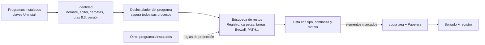

<div align="center">


# EXTIRPA

El **EX**haustive **T**race & **I**nstalled-**R**esidue **P**urge **A**gent (**E.X.T.I.R.P.A.**) es un desinstalador completo para Windows. Ejecuta el desinstalador del propio programa y después busca todo lo que el programa dejó atrás: carpetas, archivos, claves y valores del Registro, servicios, tareas programadas, reglas del firewall, elementos de inicio, accesos directos, entradas del menú contextual, tipos de archivo y entradas del PATH. Escrito desde cero en C, sin runtime y sin biblioteca C: un único ejecutable de unos 240 KB.

[English](../../README.md) · [Português (Brasil)](README.pt-BR.md) · **Español** · [Français](README.fr-FR.md) · [中文](README.zh-CN.md) · [हिन्दी](README.hi-IN.md) · [العربية](README.ar.md) · [বাংলা](README.bn-BD.md)

   

</div>

---

## Por qué EXTIRPA

El desinstalador que trae cada programa suele borrar sus archivos y quedarse ahí. Configuraciones en el Registro, carpetas en AppData, la tarea programada que buscaba actualizaciones, la regla del firewall, la entrada del menú contextual, la carpeta añadida al PATH: todo eso se queda y se acumula programa tras programa.

EXTIRPA primero quita el programa como corresponde, con su propio desinstalador, y después busca los restos. Sus objetivos:

- **Completo:** busca en todos los lugares donde un programa suele escribir, desde AppData hasta las tareas programadas y las reglas del firewall (la lista completa está abajo).
- **Seguro:** nunca toca lo que pertenece a Windows o a otro programa instalado, hace copia del Registro antes de borrar y envía los archivos a la Papelera.
- **Transparente:** cada elemento muestra su tipo, un nivel de confianza y el motivo por el que se encontró. Solo los de confianza alta vienen marcados.
- **Ligero:** un ejecutable nativo de unos 240 KB, sin instalador, sin servicios y sin telemetría. Hace su trabajo y se cierra.
- **Código abierto:** el código es totalmente auditable, y puedes compilar tu propia versión y cambiar lo que quieras.

## Por qué el nombre

**Extirpar** es arrancar de raíz, para que nada vuelva a crecer. Eso hace EXTIRPA con un programa: no quita solo lo que se ve, va a por las raíces que el programa extendió por el sistema.

El nombre también es un acrónimo:

- **EX**haustive (exhaustivo): busca en todos los lugares donde un programa puede dejar algo, no solo en la carpeta de instalación.
- **T**race (rastro): sigue los rastros del programa, las rutas y nombres que escribió en el Registro, tareas, accesos directos y configuraciones, y también puede rastrear una instalación mientras ocurre.
- **I**nstalled-**R**esidue (residuo de la instalación): el objetivo es lo que la instalación dejó atrás cuando el desinstalador terminó.
- **P**urge **A**gent (agente de eliminación): elimina esos residuos, con copia del Registro y pasando por la Papelera.

Junta las iniciales: **E.X.T.I.R.P.A.**

## Funciones

- **Desinstalar:** ejecuta el desinstalador del programa y espera a que terminen él y todos los procesos que abra (job object); después busca los restos.
- **Tres modos de búsqueda:** Seguro (nombres exactos y la carpeta de instalación), Moderado (también inicio, servicios, accesos directos, tareas programadas, reglas del firewall, tipos de archivo y todo lo que apunta a la carpeta del programa; recomendado) y Avanzado (también nombres parecidos y un análisis profundo del Registro en busca de cualquier valor que apunte al programa).
- **Dónde busca:** la carpeta de instalación (y la del editor que la contiene, si queda vacía); Archivos de programa, ProgramData, AppData (Roaming, Local, LocalLow) y las carpetas del editor; claves del Registro en SOFTWARE (64 y 32 bits, equipo y usuario); Run, RunOnce y los interruptores de inicio del Administrador de tareas; servicios; tareas programadas; reglas del Firewall de Windows; la variable PATH (del sistema y del usuario); App Paths y SharedDLLs; tipos de archivo (ProgIDs), listas "Abrir con" y asociaciones predeterminadas; componentes COM y bibliotecas de tipos; entradas del menú contextual y extensiones del Explorador (handlers, iconos superpuestos, extensiones aprobadas); reproducción automática (AutoPlay); paquetes de Windows registrados por el programa (como el del menú contextual de Windows 11); Software\Clients y RegisteredApplications; accesos directos en el escritorio, el menú Inicio, la carpeta Inicio y anclados en la barra de tareas; rastros de uso que Windows guarda por programa (MuiCache, configuración de compatibilidad, UserAssist, Jump Lists). También reconoce rutas escritas en formato corto 8.3 (`C:\PROGRA~1\...`).
- **Desinstalación rápida y por lotes:** selecciona varios programas y desinstálalos uno tras otro. Cuando el desinstalador lo permite, se ejecuta en silencio: Windows Installer (MSI), Inno Setup y NSIS se reconocen automáticamente, además del `QuietUninstallString` que registran algunos programas.
- **Desinstalación forzada:** elimina los restos de un programa que ya no está, que se rompió o que no tiene desinstalador. Indica su nombre, su carpeta o ambos.
- **Rastreo de instalación:** toma una instantánea del Registro y las carpetas, ejecuta el instalador, toma otra y guarda lo que creó la instalación. Después, "Uninstall using trace" quita exactamente eso.
- **Modo cazador:** la ventana se convierte en una mira en la esquina de la pantalla. Suéltala sobre la ventana de cualquier programa para desinstalarlo, abrir su carpeta, cerrarlo o quitarlo del inicio.
- **Aplicaciones de Windows:** lista las aplicaciones de Microsoft Store y las que vienen con Windows y las quita para el usuario actual o para todos.
- **Administrador de inicio:** activa, desactiva (el mismo interruptor del Administrador de tareas) o elimina lo que arranca con Windows, en el Registro y en las carpetas Inicio.
- **Copias de seguridad:** antes de cada borrado en el Registro se crea un archivo `.reg` que lo restaura todo con doble clic (o desde la pestaña Backups), los archivos van a la Papelera, las tareas programadas quitadas se guardan como `.xml`, y se puede crear un punto de restauración de Windows antes de cada desinstalación.
- **Todo registrado:** cada borrado, fallo y copia va a `%LOCALAPPDATA%\EXTIRPA\extirpa.log`.
- **Interfaz en portugués (Brasil) e inglés** (en inglés para los demás idiomas de Windows), y nítida en cualquier escala (DPI por monitor).

## Primeros pasos

1. Descarga `extirpa.exe` de la [última versión](https://github.com/MatheusRFC/extirpa/releases/latest) y guárdalo donde quieras, por ejemplo `C:\Herramientas`. No hay nada que instalar.
2. Ejecútalo. Windows pide permisos de administrador (necesarios para quitar programas instalados para todos los usuarios) y SmartScreen avisa porque el programa no está firmado: elige **Más información → Ejecutar de todas formas**.
3. Elige un programa y pulsa **Uninstall**. Escoge el modo de búsqueda, confirma y sigue el desinstalador del propio programa.
4. Al terminar, EXTIRPA muestra los restos que encontró. Revisa la lista, desmarca lo que quieras conservar y pulsa **Delete checked**.

EXTIRPA no se inicia con Windows, no tiene servicios en segundo plano y no deja nada en ejecución: lo cierras y se acabó. Sus datos (copias, rastreos, registro y configuración) están en `%LOCALAPPDATA%\EXTIRPA`.

### Teclado

| Tecla | Acción |
|---|---|
| `Ctrl+F` | Buscar en la lista actual |
| `F5` | Actualizar |
| `Supr` / doble clic | Desinstalar el programa seleccionado |
| `Esc` | Borrar la búsqueda |

## Cómo funciona



1. Antes de desinstalar, EXTIRPA lee todo lo que identifica al programa: su nombre sin versión ni arquitectura, el editor, sus carpetas (también en formato corto 8.3) y los nombres de sus ejecutables. Después del desinstalador la entrada del programa desaparece, así que esto tiene que hacerse antes.
2. Ejecuta el desinstalador y espera a que terminen él y todos los procesos que abra.
3. Busca los restos. Cada elemento recibe un nivel de confianza: **alta** (nombre exacto, la carpeta del propio programa o algo que apunta dentro de ella; viene marcado), **media** (nombre parecido, referencia indirecta; desmarcado) o **baja** (ambiguo; desmarcado).
4. Borra solo lo que dejes marcado: primero la copia del Registro, luego servicios y tareas programadas, reglas del firewall y PATH, Registro y, por último, los archivos a través de la Papelera. Las carpetas en uso se pueden programar para el siguiente reinicio.

## Seguridad

Borrar de más es peor que borrar de menos, así que EXTIRPA se construyó alrededor de reglas que protegen el resto del sistema:

- **Lista de protección:** las carpetas del sistema (Windows, la propia Archivos de programa, carpetas del usuario, el propio AppData, menú Inicio...) y las zonas del Registro que pertenecen a Windows (`HKLM\SYSTEM`, datos de Windows Installer, directivas, las raíces de tipos de archivo y COM...) nunca se borran, ni ninguna carpeta o clave que las contenga. La protección se comprueba cuando el elemento entra en la lista y otra vez justo antes de borrar.
- **Gana la carpeta más específica:** una ruta dentro de `C:\Program Files\Editor\Otro` pertenece al programa instalado ahí, no a uno instalado en `C:\Program Files\Editor`.
- **Los nombres compartidos con otro programa instalado** (dos versiones de Python comparten "Python", por ejemplo) vienen desmarcados, y EXTIRPA busca dentro de ellos la parte que pertenece solo al programa que se quita.
- **Las carpetas que contienen otro programa instalado** se quitan elemento por elemento, conservando el otro programa.
- **Las tareas programadas del propio Windows** (`\Microsoft\...`) nunca se tocan.

Más en [SECURITY.md](../../SECURITY.md).

## Compilar desde el código fuente

EXTIRPA solo necesita LLVM (clang, lld-link, llvm-rc y llvm-dlltool), en Windows o Linux. Sin SDK de Windows, MinGW ni biblioteca C: las declaraciones de Windows que usa están en `src/win/win32.h`, escritas a mano y comprobadas contra las cabeceras oficiales de mingw-w64 con `tools/check_win32.py`.

```bash
python3 tools/build.py test      # pruebas: el núcleo y la parte de Windows sobre un Registro y un disco simulados
python3 tools/build.py           # build/extirpa.exe
python3 tools/build.py all       # pruebas, extirpa.exe y extirpa-selftest.exe
python3 scripts/package.py       # archivos de la versión en dist/
```

`extirpa-selftest.exe --selftest` ejecuta una autoprueba en un Windows real y guarda un informe y capturas de pantalla en `%LOCALAPPDATA%\EXTIRPA\selftest`. Iconos: `python3 tools/gerar_icones.py` (necesita Pillow); el dibujo maestro es `assets/extirpa.svg`.

## Historia del proyecto

Consulta el [CHANGELOG.md](../../CHANGELOG.md). EXTIRPA empezó en octubre de 2026 como proyecto personal, el quinto después de RAJADA, VISOR, ELMO y MIRA, para tener un desinstalador propio en lugar de depender de licencias de terceros.

## Licencia

EXTIRPA es software libre bajo la [Licencia MIT](../../LICENSE).
