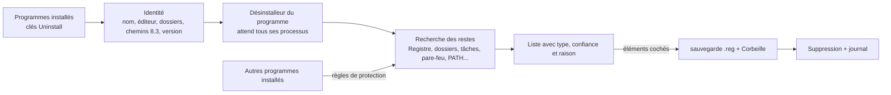

<div align="center">


# EXTIRPA

L'**EX**haustive **T**race & **I**nstalled-**R**esidue **P**urge **A**gent (**E.X.T.I.R.P.A.**) est un désinstalleur complet pour Windows. Il lance le désinstalleur du programme lui-même, puis traque tout ce que le programme a laissé derrière lui : dossiers, fichiers, clés et valeurs du Registre, services, tâches planifiées, règles du pare-feu, éléments de démarrage, raccourcis, entrées du menu contextuel, types de fichiers et entrées du PATH. Écrit à partir de zéro en C, sans runtime ni bibliothèque C : un seul exécutable d'environ 250 Ko.

[English](../../README.md) · [Português (Brasil)](README.pt-BR.md) · [Español](README.es-ES.md) · **Français** · [中文](README.zh-CN.md) · [हिन्दी](README.hi-IN.md) · [العربية](README.ar.md) · [বাংলা](README.bn-BD.md)

   

</div>

---

## Pourquoi EXTIRPA

Le désinstalleur fourni avec chaque programme supprime en général ses fichiers et s'arrête là. Réglages dans le Registre, dossiers dans AppData, tâche planifiée qui cherchait des mises à jour, règle du pare-feu, entrée du menu contextuel, dossier ajouté au PATH : tout cela reste, et s'accumule programme après programme.

EXTIRPA retire d'abord le programme correctement, avec son propre désinstalleur, puis cherche les restes. Ses objectifs :

- **Complet :** il cherche partout où un programme écrit d'habitude, d'AppData jusqu'aux tâches planifiées et aux règles du pare-feu (la liste complète est plus bas).
- **Sûr :** il ne touche jamais à ce qui appartient à Windows ou à un autre programme installé, sauvegarde le Registre avant de supprimer et envoie les fichiers à la Corbeille.
- **Transparent :** chaque élément indique son type, un niveau de confiance et la raison pour laquelle il a été trouvé. Seuls les éléments de confiance élevée sont cochés.
- **Léger :** un exécutable natif d'environ 250 Ko, sans installation, sans service, sans télémétrie. Il fait son travail et se ferme.
- **Open source :** le code est entièrement vérifiable, et vous pouvez compiler votre propre version et modifier ce que vous voulez.

## Pourquoi ce nom

**Extirper** (en portugais *extirpar*), c'est arracher avec les racines, pour que rien ne repousse. C'est ce qu'EXTIRPA fait d'un programme : il ne retire pas seulement ce qui se voit, il s'attaque aux racines que le programme a étendues dans le système.

Le nom est aussi un acronyme :

- **EX**haustive (exhaustif) : il cherche partout où un programme peut laisser quelque chose, pas seulement dans le dossier d'installation.
- **T**race : il suit les traces du programme, les chemins et les noms qu'il a écrits dans le Registre, les tâches, les raccourcis et les réglages, et il peut aussi tracer une installation pendant qu'elle a lieu.
- **I**nstalled-**R**esidue (résidu d'installation) : sa cible est ce que l'installation a laissé une fois le désinstalleur terminé.
- **P**urge **A**gent (agent de suppression) : il supprime ces résidus, avec une sauvegarde du Registre et en passant par la Corbeille.

Les initiales réunies : **E.X.T.I.R.P.A.**

## Fonctionnalités

- **Désinstaller :** lance le désinstalleur du programme et attend qu'il se termine, ainsi que tous les processus qu'il démarre (job object), puis cherche les restes.
- **Trois modes de recherche :** Sûr (noms exacts et dossier d'installation), Modéré (aussi le démarrage, les services, les raccourcis, les tâches planifiées, les règles du pare-feu, les types de fichiers et tout ce qui pointe vers le dossier du programme ; recommandé) et Avancé (aussi les noms proches et une analyse approfondie du Registre pour toute valeur qui pointe vers le programme).
- **Où il cherche :** le dossier d'installation (et celui de l'éditeur qui le contient, s'il reste vide) ; Program Files, ProgramData, AppData (Roaming, Local, LocalLow) et les dossiers de l'éditeur ; les clés du Registre sous SOFTWARE (64 et 32 bits, machine et utilisateur) ; Run, RunOnce et les interrupteurs de démarrage du Gestionnaire des tâches ; les services ; les tâches planifiées ; les règles du Pare-feu Windows ; la variable PATH (système et utilisateur) ; App Paths et SharedDLLs ; les types de fichiers (ProgIDs), les listes « Ouvrir avec » et les associations par défaut ; les composants COM et les bibliothèques de types ; les entrées du menu contextuel et les extensions de l'Explorateur (gestionnaires, icônes superposées, extensions approuvées) ; l'exécution automatique (AutoPlay) ; les paquets Windows enregistrés par le programme (comme celui du menu contextuel de Windows 11) ; Software\Clients et RegisteredApplications ; les raccourcis du bureau, du menu Démarrer, du dossier Démarrage et épinglés à la barre des tâches ; les traces d'utilisation que Windows conserve par programme (MuiCache, paramètres de compatibilité, UserAssist, Jump Lists, la liste des raccourcis utilisés du menu Démarrer). Les chemins écrits au format court 8.3 (`C:\PROGRA~1\...`) sont aussi reconnus. Pour les programmes Windows Installer (MSI) qui n'enregistrent pas leur dossier d'installation, EXTIRPA le retrouve grâce aux composants enregistrés par l'installateur, à App Paths et aux raccourcis du menu Démarrer.
- **Désinstallation rapide et par lot :** sélectionnez plusieurs programmes et désinstallez-les à la suite. Quand le désinstalleur le permet, il s'exécute en silence : Windows Installer (MSI), Inno Setup et NSIS sont reconnus automatiquement, en plus du `QuietUninstallString` que certains programmes enregistrent.
- **Désinstallation forcée :** supprime les restes d'un programme déjà parti, cassé ou sans désinstalleur. Indiquez son nom, son dossier ou les deux.
- **Traçage d'installation :** prend un instantané du Registre et des dossiers, lance l'installateur, en prend un autre et enregistre ce que l'installation a créé. Plus tard, « Uninstall using trace » retire exactement cela.
- **Mode chasseur :** la fenêtre devient un viseur dans le coin de l'écran. Lâchez-le sur la fenêtre de n'importe quel programme pour le désinstaller, ouvrir son dossier, le fermer ou l'empêcher de démarrer avec Windows.
- **Applications Windows :** liste les applications du Microsoft Store et celles fournies avec Windows, et les retire pour l'utilisateur actuel ou pour tous les utilisateurs.
- **Gestionnaire de démarrage :** active, désactive (le même interrupteur que le Gestionnaire des tâches) ou supprime ce qui démarre avec Windows, dans le Registre et les dossiers Démarrage.
- **Sauvegardes :** chaque suppression dans le Registre est précédée d'un fichier `.reg` qui restaure tout d'un double-clic (ou depuis l'onglet Backups), les fichiers vont à la Corbeille, les tâches planifiées retirées sont enregistrées en `.xml`, et un point de restauration Windows peut être créé avant chaque désinstallation.
- **Tout est journalisé :** chaque suppression, échec et sauvegarde va dans `%LOCALAPPDATA%\EXTIRPA\extirpa.log`.
- **Interface en portugais (Brésil) et en anglais** (en anglais pour les autres langues de Windows), nette à toutes les échelles (DPI par écran).

## Pour commencer

1. Téléchargez `extirpa.exe` depuis la [dernière version](https://github.com/MatheusRFC/extirpa/releases/latest) et enregistrez-le où vous voulez, par exemple `C:\Outils`. Il n'y a rien à installer.
2. Lancez-le. Windows demande les droits d'administrateur (nécessaires pour retirer les programmes installés pour tous les utilisateurs) et SmartScreen avertit car le programme n'est pas signé : choisissez **Informations complémentaires → Exécuter quand même**.
3. Choisissez un programme et cliquez sur **Uninstall**. Choisissez le mode de recherche, confirmez et suivez le désinstalleur du programme.
4. À la fin, EXTIRPA affiche les restes trouvés. Vérifiez la liste, décochez ce que vous voulez garder et cliquez sur **Delete checked**.

EXTIRPA ne démarre pas avec Windows, n'a pas de service en arrière-plan et ne laisse rien tourner : une fois fermé, il n'y a plus rien. Ses données (sauvegardes, traçages, journal et réglages) se trouvent dans `%LOCALAPPDATA%\EXTIRPA`.

### Clavier

| Touche | Action |
|---|---|
| `Ctrl+F` | Rechercher dans la liste affichée |
| `F5` | Actualiser |
| `Suppr` / double-clic | Désinstaller le programme sélectionné |
| `Échap` | Effacer la recherche |

## Fonctionnement



1. Avant de désinstaller, EXTIRPA lit tout ce qui identifie le programme : son nom sans version ni architecture, l'éditeur, ses dossiers (aussi au format court 8.3) et les noms de ses exécutables. Après le désinstalleur, l'entrée du programme disparaît : cela doit donc se faire avant.
2. Il lance le désinstalleur et attend qu'il se termine, ainsi que tous les processus qu'il démarre.
3. Il cherche les restes. Chaque élément reçoit un niveau de confiance : **élevé** (nom exact, le dossier du programme ou quelque chose qui pointe dedans ; coché), **moyen** (nom proche, référence indirecte ; décoché) ou **faible** (ambigu ; décoché).
4. Il ne supprime que ce que vous laissez coché : d'abord la sauvegarde du Registre, puis les services et tâches planifiées, les règles du pare-feu et le PATH, le Registre et enfin les fichiers via la Corbeille. Les dossiers en cours d'utilisation peuvent être programmés pour le prochain redémarrage.

## Sécurité

Supprimer trop est pire que supprimer trop peu ; EXTIRPA est donc construit autour de règles qui protègent le reste du système :

- **Liste de protection :** les dossiers du système (Windows, Program Files lui-même, les dossiers de l'utilisateur, AppData lui-même, le menu Démarrer...) et les zones du Registre qui appartiennent à Windows (`HKLM\SYSTEM`, les données de Windows Installer, les stratégies, les racines des types de fichiers et de COM...) ne sont jamais supprimés, ni aucun dossier ou clé qui les contient. La protection est vérifiée quand l'élément entre dans la liste et de nouveau juste avant la suppression.
- **Le dossier le plus précis l'emporte :** un chemin dans `C:\Program Files\Editeur\Autre` appartient au programme installé là, pas à celui installé dans `C:\Program Files\Editeur`.
- **Les noms partagés avec un autre programme installé** (deux versions de Python partagent « Python », par exemple) sont décochés, et EXTIRPA cherche à l'intérieur la partie qui n'appartient qu'au programme retiré.
- **Les dossiers qui contiennent un autre programme installé** sont retirés élément par élément, en conservant l'autre programme.
- **Les tâches planifiées de Windows** (`\Microsoft\...`) ne sont jamais touchées.

Plus de détails dans [SECURITY.md](../../SECURITY.md).

## Compiler depuis les sources

EXTIRPA n'a besoin que de LLVM (clang, lld-link, llvm-rc et llvm-dlltool), sous Windows ou Linux. Pas de SDK Windows, de MinGW ni de bibliothèque C : les déclarations Windows qu'il utilise sont dans `src/win/win32.h`, écrites à la main et vérifiées par rapport aux en-têtes officiels de mingw-w64 avec `tools/check_win32.py`.

```bash
python3 tools/build.py test      # tests : le noyau et la partie Windows sur un Registre et un disque simulés
python3 tools/build.py           # build/extirpa.exe
python3 tools/build.py all       # tests, extirpa.exe et extirpa-selftest.exe
python3 scripts/package.py       # fichiers de la version dans dist/
```

`extirpa-selftest.exe --selftest` lance un autotest sur un vrai Windows et enregistre un rapport et des captures d'écran dans `%LOCALAPPDATA%\EXTIRPA\selftest`. Icônes : `python3 tools/gerar_icones.py` (nécessite Pillow) ; le dessin de référence est `assets/extirpa.svg`.

## Historique du projet

Voir [CHANGELOG.md](../../CHANGELOG.md). EXTIRPA a commencé en octobre 2026 comme projet personnel, le cinquième après RAJADA, VISOR, ELMO et MIRA, pour avoir mon propre désinstalleur au lieu de dépendre de licences de tiers.

## Licence

EXTIRPA est un logiciel libre sous [licence MIT](../../LICENSE).
