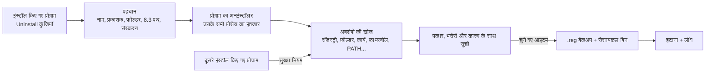

<div align="center">


# EXTIRPA

**EX**haustive **T**race & **I**nstalled-**R**esidue **P**urge **A**gent (**E.X.T.I.R.P.A.**) Windows के लिए एक पूरा अनइंस्टॉलर है। यह पहले प्रोग्राम का अपना अनइंस्टॉलर चलाता है और फिर वह सब कुछ ढूँढ़ता है जो प्रोग्राम पीछे छोड़ गया: फ़ोल्डर, फ़ाइलें, रजिस्ट्री की कुंजियाँ और मान, सेवाएँ, शेड्यूल किए गए कार्य, फ़ायरवॉल नियम, स्टार्टअप प्रविष्टियाँ, शॉर्टकट, कॉन्टेक्स्ट मेनू प्रविष्टियाँ, फ़ाइल प्रकार और PATH प्रविष्टियाँ। शुरू से C में लिखा गया, बिना रनटाइम और बिना C लाइब्रेरी के: लगभग 270 KB की एक ही एक्ज़ीक्यूटेबल फ़ाइल।

[English](../../README.md) · [Português (Brasil)](README.pt-BR.md) · [Español](README.es-ES.md) · [Français](README.fr-FR.md) · [中文](README.zh-CN.md) · **हिन्दी** · [العربية](README.ar.md) · [বাংলা](README.bn-BD.md)

   

</div>

---

## EXTIRPA क्यों

प्रोग्राम के साथ आने वाले अनइंस्टॉलर आमतौर पर प्रोग्राम की फ़ाइलें हटाकर रुक जाते हैं। रजिस्ट्री की सेटिंग्स, AppData के फ़ोल्डर, अपडेट जाँचने वाला शेड्यूल किया गया कार्य, फ़ायरवॉल नियम, कॉन्टेक्स्ट मेनू की प्रविष्टि, PATH में जोड़ा गया फ़ोल्डर: यह सब पीछे रह जाता है और एक के बाद एक प्रोग्राम के साथ जमा होता जाता है।

EXTIRPA पहले प्रोग्राम को सही तरीक़े से, उसके अपने अनइंस्टॉलर से हटाता है, और फिर बचे हुए अवशेष ढूँढ़ता है। इसके लक्ष्य:

- **पूरी तरह:** यह हर उस जगह खोजता है जहाँ प्रोग्राम आमतौर पर लिखते हैं, AppData से लेकर शेड्यूल किए गए कार्यों और फ़ायरवॉल नियमों तक (पूरी सूची नीचे है)।
- **सुरक्षित:** यह Windows या किसी दूसरे इंस्टॉल किए गए प्रोग्राम की चीज़ों को कभी नहीं छूता, हटाने से पहले रजिस्ट्री का बैकअप लेता है और फ़ाइलों को रीसायकल बिन में भेजता है।
- **पारदर्शी:** हर आइटम के साथ उसका प्रकार, भरोसे का स्तर और मिलने का कारण दिखता है। केवल उच्च भरोसे वाले आइटम पहले से चुने होते हैं।
- **हल्का:** लगभग 270 KB की एक नेटिव एक्ज़ीक्यूटेबल, कोई इंस्टॉलर नहीं, कोई सेवा नहीं, कोई टेलीमेट्री नहीं। अपना काम करता है और बंद हो जाता है।
- **ओपन सोर्स:** कोड पूरी तरह जाँचा जा सकता है, और आप अपना संस्करण खुद बना सकते हैं और जो चाहें बदल सकते हैं।

## नाम क्यों

**Extirpar** (पुर्तगाली में "जड़ से उखाड़ना") का अर्थ है किसी चीज़ को जड़ समेत उखाड़ देना, ताकि वह फिर न उगे। EXTIRPA प्रोग्राम के साथ यही करता है: यह केवल दिखने वाली चीज़ें नहीं हटाता, बल्कि उन जड़ों तक जाता है जो प्रोग्राम ने सिस्टम में फैला दी थीं।

यह नाम एक संक्षिप्त रूप भी है:

- **EX**haustive (पूर्ण): हर उस जगह खोजता है जहाँ प्रोग्राम कुछ छोड़ सकता है, केवल इंस्टॉल फ़ोल्डर में नहीं।
- **T**race (निशान): प्रोग्राम के निशानों का पीछा करता है, यानी वे पथ और नाम जो उसने रजिस्ट्री, कार्यों, शॉर्टकट और सेटिंग्स में लिखे; और यह किसी इंस्टॉलेशन को होते समय ट्रेस भी कर सकता है।
- **I**nstalled-**R**esidue (इंस्टॉलेशन के अवशेष): इसका लक्ष्य वह है जो अनइंस्टॉलर के खत्म होने के बाद इंस्टॉलेशन पीछे छोड़ गया।
- **P**urge **A**gent (सफ़ाई एजेंट): इन अवशेषों को हटाता है, रजिस्ट्री के बैकअप के साथ और रीसायकल बिन के ज़रिए।

आद्याक्षरों को मिलाएँ: **E.X.T.I.R.P.A.**

## सुविधाएँ

- **अनइंस्टॉल:** प्रोग्राम का अनइंस्टॉलर चलाता है और उसके तथा उसके शुरू किए गए सभी प्रोसेस के खत्म होने का इंतज़ार करता है (job object), फिर अवशेष खोजता है।
- **खोज के तीन मोड:** सुरक्षित (सटीक नाम और इंस्टॉल फ़ोल्डर), मध्यम (स्टार्टअप प्रविष्टियाँ, सेवाएँ, शॉर्टकट, शेड्यूल किए गए कार्य, फ़ायरवॉल नियम, फ़ाइल प्रकार और प्रोग्राम के फ़ोल्डर की ओर इशारा करने वाली हर चीज़ भी; सुझाया गया), उन्नत (मिलते-जुलते नाम भी, और रजिस्ट्री में प्रोग्राम की ओर इशारा करने वाले किसी भी मान की गहरी खोज)।
- **यह कहाँ खोजता है:** इंस्टॉल फ़ोल्डर (और उसे रखने वाला प्रकाशक का फ़ोल्डर, अगर खाली रह जाए); Program Files, ProgramData, AppData (Roaming, Local, LocalLow) और प्रकाशक के फ़ोल्डर; SOFTWARE के नीचे रजिस्ट्री कुंजियाँ (64 और 32 बिट, मशीन और उपयोगकर्ता); Run, RunOnce और टास्क मैनेजर के स्टार्टअप स्विच; सेवाएँ; शेड्यूल किए गए कार्य; Windows फ़ायरवॉल नियम; PATH वेरिएबल (सिस्टम और उपयोगकर्ता); App Paths और SharedDLLs; फ़ाइल प्रकार (ProgID), "इसके साथ खोलें" सूचियाँ और डिफ़ॉल्ट संबद्धताएँ; COM घटक और टाइप लाइब्रेरी; कॉन्टेक्स्ट मेनू प्रविष्टियाँ और Explorer एक्सटेंशन (हैंडलर, आइकन ओवरले, स्वीकृत एक्सटेंशन); ऑटोप्ले (AutoPlay) हैंडलर; प्रोग्राम द्वारा पंजीकृत Windows पैकेज (जैसे Windows 11 कॉन्टेक्स्ट मेनू का पैकेज); Software\Clients और RegisteredApplications; डेस्कटॉप, स्टार्ट मेनू, स्टार्टअप फ़ोल्डर के शॉर्टकट और टास्कबार पर पिन किए गए शॉर्टकट; Windows द्वारा हर प्रोग्राम के लिए रखे गए उपयोग के निशान (MuiCache, संगतता सेटिंग्स, UserAssist, जंप लिस्ट, स्टार्ट मेनू में इस्तेमाल किए गए शॉर्टकट की सूची)। छोटे 8.3 रूप में लिखे पथ (`C:\PROGRA~1\...`) भी पहचाने जाते हैं। जो Windows Installer (MSI) प्रोग्राम अपना इंस्टॉल फ़ोल्डर दर्ज नहीं करते, उनका फ़ोल्डर EXTIRPA इंस्टॉलर के घटक रिकॉर्ड, App Paths और स्टार्ट मेनू के शॉर्टकट से ढूँढता है। यह वह भी ढूँढता है जो Windows प्रोग्राम के एक्ज़ीक्यूटेबल के नाम से रखता है (Prefetch फ़ाइलें, क्रैश डंप, त्रुटि रिपोर्ट, नेटवर्क ट्रेसिंग कुंजियाँ) और वह जो Windows Installer किसी MSI प्रोग्राम का रखता है (उसका पंजीकरण, कैश किया गया पैकेज और दर्ज फ़ोल्डर)।
- **त्वरित और बैच अनइंस्टॉल:** कई प्रोग्राम चुनें और उन्हें एक के बाद एक अनइंस्टॉल करें। जब अनइंस्टॉलर अनुमति देता है, तो यह बिना कुछ पूछे चलता है: Windows Installer (MSI), Inno Setup और NSIS अपने-आप पहचाने जाते हैं, साथ ही वह `QuietUninstallString` भी जो कुछ प्रोग्राम दर्ज करते हैं।
- **ज़बरदस्ती अनइंस्टॉल:** ऐसे प्रोग्राम के अवशेष हटाता है जो पहले ही हट चुका है, टूट गया है या जिसका कोई अनइंस्टॉलर नहीं है। उसका नाम, उसका फ़ोल्डर या दोनों दें।
- **इंस्टॉलेशन ट्रेसिंग:** रजिस्ट्री और फ़ोल्डरों का स्नैपशॉट लेता है, इंस्टॉलर चलाता है, फिर एक और स्नैपशॉट लेता है और इंस्टॉलेशन ने जो बनाया उसे सहेजता है। बाद में "Uninstall using trace" ठीक वही हटा देता है।
- **हंटर मोड:** विंडो स्क्रीन के कोने में एक निशाना बन जाती है। इसे किसी भी प्रोग्राम की विंडो पर छोड़ें ताकि उसे अनइंस्टॉल करें, उसका फ़ोल्डर खोलें, उसे बंद करें या उसे Windows के साथ शुरू होने से रोकें।
- **Windows ऐप्स:** Microsoft Store के ऐप्स और Windows के साथ आने वाले ऐप्स की सूची दिखाता है और उन्हें मौजूदा उपयोगकर्ता या सभी उपयोगकर्ताओं के लिए हटाता है।
- **स्टार्टअप मैनेजर:** Windows के साथ शुरू होने वाली चीज़ों को रजिस्ट्री और स्टार्टअप फ़ोल्डरों में चालू, बंद (टास्क मैनेजर वाला वही स्विच) या हटाता है।
- **बैकअप:** रजिस्ट्री से कुछ भी हटाने से पहले एक `.reg` फ़ाइल बनती है जो डबल-क्लिक से (या Backups टैब से) सब कुछ बहाल कर देती है, फ़ाइलें रीसायकल बिन में जाती हैं, हटाए गए शेड्यूल किए गए कार्य `.xml` के रूप में सहेजे जाते हैं, और हर अनइंस्टॉल से पहले Windows रिस्टोर पॉइंट बनाया जा सकता है।
- **सब कुछ लॉग में:** हर हटाना, हर विफलता और हर बैकअप `%LOCALAPPDATA%\EXTIRPA\extirpa.log` में दर्ज होता है।
- **इंटरफ़ेस पुर्तगाली (ब्राज़ील) और अंग्रेज़ी में** (Windows की दूसरी भाषाओं में अंग्रेज़ी), और हर स्केलिंग पर साफ़ (प्रति-मॉनिटर DPI)।

## शुरुआत

1. [नवीनतम रिलीज़](https://github.com/MatheusRFC/extirpa/releases/latest) से `extirpa.exe` डाउनलोड करें और कहीं भी सहेजें, जैसे `C:\Tools`। कुछ भी इंस्टॉल नहीं करना है।
2. इसे चलाएँ। Windows व्यवस्थापक अधिकार माँगता है (सभी उपयोगकर्ताओं के लिए इंस्टॉल प्रोग्राम हटाने के लिए ज़रूरी) और SmartScreen चेतावनी देता है क्योंकि प्रोग्राम पर डिजिटल हस्ताक्षर नहीं है: **अधिक जानकारी → फिर भी चलाएँ** चुनें।
3. कोई प्रोग्राम चुनें और **Uninstall** पर क्लिक करें। खोज मोड चुनें, पुष्टि करें और प्रोग्राम के अपने अनइंस्टॉलर का पालन करें।
4. काम पूरा होने पर EXTIRPA अवशेष दो चरणों में दिखाता है: पहले रजिस्ट्री और सिस्टम के आइटम (कुंजियाँ, मान, सेवाएँ, शेड्यूल किए गए कार्य, फ़ायरवॉल नियम, PATH), फिर फ़ाइलें और फ़ोल्डर। हर चरण में सूची देखें, जो रखना है उसका चुनाव हटाएँ, **Delete checked** पर और फिर **Next** पर क्लिक करें।

EXTIRPA Windows के साथ शुरू नहीं होता, इसकी कोई बैकग्राउंड सेवा नहीं है और यह कुछ भी चलता हुआ नहीं छोड़ता: बंद करते ही काम ख़त्म। इसका डेटा (बैकअप, ट्रेस, लॉग और सेटिंग्स) `%LOCALAPPDATA%\EXTIRPA` में रहता है।

### कीबोर्ड

| कुंजी | काम |
|---|---|
| `Ctrl+F` | मौजूदा सूची में खोजें |
| `F5` | रीफ़्रेश |
| `Delete` / डबल-क्लिक | चुना हुआ प्रोग्राम अनइंस्टॉल करें |
| `Esc` | खोज साफ़ करें |

## यह कैसे काम करता है



1. अनइंस्टॉल करने से पहले EXTIRPA वह सब पढ़ता है जिससे प्रोग्राम की पहचान होती है: संस्करण और आर्किटेक्चर के बिना उसका नाम, प्रकाशक, उसके फ़ोल्डर (छोटे 8.3 रूप में भी) और उसकी एक्ज़ीक्यूटेबल फ़ाइलों के नाम। अनइंस्टॉलर चलने के बाद प्रोग्राम की प्रविष्टि गायब हो जाती है, इसलिए यह पहले करना ज़रूरी है।
2. अनइंस्टॉलर चलाता है और उसके तथा उसके शुरू किए गए सभी प्रोसेस का इंतज़ार करता है। उससे ठीक पहले, यह अभी इंस्टॉल प्रोग्राम का विश्लेषण करता है: इस विश्लेषण में जो मिला और अनइंस्टॉलर ने छोड़ दिया, वह भी अवशेष माना जाता है।
3. अवशेष खोजता है। हर आइटम को भरोसे का एक स्तर मिलता है: **उच्च** (सटीक नाम, प्रोग्राम का अपना फ़ोल्डर या उसके अंदर की ओर इशारा करने वाली कोई चीज़; पहले से चुना हुआ), **मध्यम** (मिलता-जुलता नाम, अप्रत्यक्ष संदर्भ; चुना हुआ नहीं) या **निम्न** (अस्पष्ट; चुना हुआ नहीं)।
4. केवल वही हटाता है जो आप चुना हुआ छोड़ते हैं: पहले रजिस्ट्री का बैकअप, फिर सेवाएँ और शेड्यूल किए गए कार्य, फ़ायरवॉल नियम और PATH, रजिस्ट्री, और आख़िर में रीसायकल बिन के ज़रिए फ़ाइलें। उपयोग में चल रहे फ़ोल्डरों को अगले रीस्टार्ट पर हटाने के लिए शेड्यूल किया जा सकता है।

## सुरक्षा

ज़्यादा हटाना कम हटाने से बुरा है, इसलिए EXTIRPA ऐसे नियमों के इर्द-गिर्द बना है जो बाक़ी सिस्टम की रक्षा करते हैं:

- **सुरक्षा सूची:** सिस्टम फ़ोल्डर (Windows, स्वयं Program Files, उपयोगकर्ता फ़ोल्डर, स्वयं AppData, स्टार्ट मेनू...) और Windows के रजिस्ट्री क्षेत्र (`HKLM\SYSTEM`, Windows Installer का डेटा, नीतियाँ, फ़ाइल प्रकारों और COM की जड़ें...) कभी नहीं हटाए जाते, न ही कोई ऐसा फ़ोल्डर या कुंजी जिसमें वे हों। सुरक्षा तब जाँची जाती है जब आइटम सूची में आता है, और फिर हटाने से ठीक पहले। अपवाद केवल प्रोग्राम की अपनी प्रविष्टियाँ हैं, जिन्हें सटीक रूप से पहचाना जाता है: Windows Installer में उसका पंजीकरण (प्रोडक्ट कोड से), कैश किया गया इंस्टॉलर पैकेज और उसकी Prefetch फ़ाइलें।
- **सबसे विशिष्ट फ़ोल्डर जीतता है:** `C:\Program Files\Vendor\Other` के अंदर का पथ वहाँ इंस्टॉल किए गए प्रोग्राम का है, `C:\Program Files\Vendor` में इंस्टॉल किए गए प्रोग्राम का नहीं।
- **किसी दूसरे इंस्टॉल किए गए प्रोग्राम के साथ साझा नाम** (जैसे Python के दो संस्करण "Python" साझा करते हैं) चुने हुए नहीं आते, और EXTIRPA उनके अंदर केवल हटाए जा रहे प्रोग्राम का हिस्सा खोजता है।
- **किसी दूसरे इंस्टॉल किए गए प्रोग्राम वाले फ़ोल्डर** एक-एक आइटम करके हटाए जाते हैं, दूसरे प्रोग्राम को बचाते हुए।
- **Windows के अपने शेड्यूल किए गए कार्य** (`\Microsoft\...`) कभी नहीं छुए जाते।

अधिक जानकारी [SECURITY.md](../../SECURITY.md) में।

## सोर्स से बनाना

EXTIRPA को केवल LLVM (clang, lld-link, llvm-rc और llvm-dlltool) चाहिए, Windows या Linux पर। Windows SDK, MinGW या C लाइब्रेरी की ज़रूरत नहीं: इसके उपयोग किए गए Windows घोषणाएँ `src/win/win32.h` में हैं, हाथ से लिखी हुई और `tools/check_win32.py` द्वारा mingw-w64 के आधिकारिक हेडरों से मिलान की गई।

```bash
python3 tools/build.py test      # टेस्ट: कोर, और नकली रजिस्ट्री व डिस्क पर Windows वाला भाग
python3 tools/build.py           # build/extirpa.exe
python3 tools/build.py all       # टेस्ट, extirpa.exe और extirpa-selftest.exe
python3 scripts/package.py       # रिलीज़ फ़ाइलें dist/ में
```

`extirpa-selftest.exe --selftest` असली Windows पर स्व-परीक्षण चलाता है और रिपोर्ट व स्क्रीनशॉट `%LOCALAPPDATA%\EXTIRPA\selftest` में सहेजता है। आइकन: `python3 tools/gerar_icones.py` (Pillow ज़रूरी); मूल चित्र `assets/extirpa.svg` है।

## परियोजना का इतिहास

[CHANGELOG.md](../../CHANGELOG.md) देखें। EXTIRPA अक्टूबर 2026 में एक निजी परियोजना के रूप में शुरू हुआ, RAJADA, VISOR, ELMO और MIRA के बाद पाँचवाँ, ताकि तीसरे पक्ष के लाइसेंसों पर निर्भर रहने के बजाय अपना अनइंस्टॉलर हो।

## लाइसेंस

EXTIRPA [MIT लाइसेंस](../../LICENSE) के तहत मुफ़्त सॉफ़्टवेयर है।
