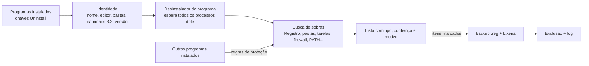

<div align="center">


# EXTIRPA

O **EX**haustive **T**race & **I**nstalled-**R**esidue **P**urge **A**gent (**E.X.T.I.R.P.A.**) é um desinstalador completo para Windows. Ele roda o desinstalador do próprio programa e depois caça tudo o que ficou para trás: pastas, arquivos, chaves e valores do Registro, serviços, tarefas agendadas, regras do firewall, itens de inicialização, atalhos, itens do menu de contexto, tipos de arquivo e entradas do PATH. Escrito do zero em C, sem runtime e sem biblioteca C: um executável só, de uns 240 KB.

[English](../../README.md) · **Português (Brasil)** · [Español](README.es-ES.md) · [Français](README.fr-FR.md) · [中文](README.zh-CN.md) · [हिन्दी](README.hi-IN.md) · [العربية](README.ar.md) · [বাংলা](README.bn-BD.md)

   

</div>

---

## Motivação

O desinstalador que vem com cada programa costuma apagar os arquivos dele e parar por aí. Configurações no Registro, pastas no AppData, a tarefa agendada que procurava atualizações, a regra do firewall, o item no menu de contexto, a pasta acrescentada ao PATH: tudo isso fica, e vai se acumulando programa após programa.

O EXTIRPA primeiro remove o programa do jeito certo, com o desinstalador dele, e depois procura as sobras. Os objetivos:

- **Completo:** procura em todos os lugares onde um programa costuma escrever, do AppData às tarefas agendadas e regras do firewall (a lista completa está abaixo).
- **Seguro:** nunca mexe no que é do Windows ou de outro programa instalado, faz backup do Registro antes de apagar e manda os arquivos para a Lixeira.
- **Transparente:** cada item vem com o tipo, um nível de confiança e o motivo de ter sido encontrado. Só os de confiança alta vêm marcados.
- **Leve:** um executável nativo de uns 240 KB, sem instalador, sem serviço, sem telemetria. Faz o trabalho e fecha.
- **Open Source:** o código é totalmente auditável, e você mesmo pode compilar sua própria versão e mudar o que quiser.

## Por que esse nome

**Extirpar** é arrancar pela raiz, para que nada volte a nascer. É o que o EXTIRPA faz com um programa: não tira só o que aparece, vai atrás das raízes que o programa espalhou pelo sistema.

O nome também é um acrônimo:

- **EX**haustive (exaustivo): procura em todo lugar onde um programa pode deixar alguma coisa, não só na pasta de instalação.
- **T**race (rastro): segue os rastros do programa, os caminhos e nomes que ele gravou no Registro, em tarefas, atalhos e configurações, e também consegue rastrear uma instalação enquanto ela acontece.
- **I**nstalled-**R**esidue (resíduo da instalação): o alvo é o que a instalação deixou para trás depois que o desinstalador terminou.
- **P**urge **A**gent (agente de remoção): remove esses resíduos, com backup do Registro e passando pela Lixeira.

Juntando as iniciais: **E.X.T.I.R.P.A.**

## Recursos

- **Desinstalar:** roda o desinstalador do programa e espera ele e todos os processos que ele abrir terminarem (job object); depois procura as sobras.
- **Três modos de busca:** Seguro (nomes exatos e a pasta de instalação), Moderado (também inicialização, serviços, atalhos, tarefas agendadas, regras do firewall, tipos de arquivo e tudo o que aponta para a pasta do programa; recomendado) e Avançado (também nomes parecidos e uma varredura profunda do Registro atrás de qualquer valor que aponte para o programa).
- **Onde ele procura:** a pasta de instalação (e a do editor em volta dela, se ficar vazia); Arquivos de Programas, ProgramData, AppData (Roaming, Local, LocalLow) e as pastas do editor; chaves do Registro em SOFTWARE (64 e 32 bits, máquina e usuário); Run, RunOnce e os botões de inicialização do Gerenciador de Tarefas; serviços; tarefas agendadas; regras do Firewall do Windows; a variável PATH (do sistema e do usuário); App Paths e SharedDLLs; tipos de arquivo (ProgIDs), listas "Abrir com" e associações padrão; componentes COM e bibliotecas de tipos; itens do menu de contexto e extensões do Explorer (handlers, ícones sobrepostos, extensões aprovadas); reprodução automática (AutoPlay); pacotes do Windows registrados pelo programa (como o do menu de contexto do Windows 11); Software\Clients e RegisteredApplications; atalhos na área de trabalho, no menu Iniciar, na pasta Inicializar e fixados na barra de tarefas; rastros de uso que o Windows guarda por programa (MuiCache, configurações de compatibilidade, UserAssist, Jump Lists). Caminhos gravados no formato curto 8.3 (`C:\PROGRA~1\...`) também são reconhecidos.
- **Desinstalação rápida e em lote:** selecione vários programas e desinstale todos em sequência. Quando o desinstalador permite, ele roda em modo silencioso: Windows Installer (MSI), Inno Setup e NSIS são reconhecidos sozinhos, além do `QuietUninstallString` que alguns programas registram.
- **Desinstalação forçada:** remove as sobras de um programa que já saiu, quebrou ou não tem desinstalador. Informe o nome, a pasta ou os dois.
- **Rastreamento de instalação:** tira uma foto do Registro e das pastas, roda o instalador, tira outra foto e salva o que a instalação criou. Depois, "Desinstalar pelo rastreamento" remove exatamente isso.
- **Modo caçador:** a janela vira uma mira no canto da tela. Solte a mira sobre a janela de qualquer programa para desinstalar, abrir a pasta, encerrar ou tirar da inicialização.
- **Apps do Windows:** lista os aplicativos da Microsoft Store e os que vêm com o Windows e remove para o usuário atual ou para todos os usuários.
- **Gerenciador de inicialização:** ativa, desativa (o mesmo botão do Gerenciador de Tarefas) ou exclui o que abre com o Windows, no Registro e nas pastas Inicializar.
- **Backups:** toda exclusão no Registro é precedida de um arquivo `.reg` que restaura tudo com um clique duplo (ou pela aba Backups), os arquivos vão para a Lixeira, as tarefas agendadas removidas são salvas em `.xml`, e um ponto de restauração do Windows pode ser criado antes de cada desinstalação.
- **Tudo registrado:** cada exclusão, falha e backup vai para `%LOCALAPPDATA%\EXTIRPA\extirpa.log`.
- **Interface em português (Brasil) e inglês**, conforme o idioma do Windows, e nítida em qualquer escala (DPI por monitor).

## Como usar

1. Baixe o `extirpa.exe` da [release mais recente](https://github.com/MatheusRFC/extirpa/releases/latest) e salve onde quiser, por exemplo `C:\Ferramentas`. Não há nada para instalar.
2. Execute. O Windows pede permissão de administrador (necessária para remover programas instalados para todos os usuários) e o SmartScreen avisa porque o programa não é assinado digitalmente: escolha **Mais informações → Executar assim mesmo**.
3. Escolha um programa e clique em **Desinstalar**. Escolha o modo de busca, confirme e siga o desinstalador do próprio programa.
4. No fim, o EXTIRPA mostra as sobras que encontrou. Confira a lista, desmarque o que quiser manter e clique em **Excluir marcados**.

O EXTIRPA não inicia com o Windows, não tem serviço rodando por trás e não deixa nada aberto: fechou, acabou. Os dados dele (backups, rastreamentos, log e configurações) ficam em `%LOCALAPPDATA%\EXTIRPA`.

### Teclado

| Tecla | Ação |
|---|---|
| `Ctrl+F` | Pesquisar na lista atual |
| `F5` | Atualizar |
| `Delete` / clique duplo | Desinstalar o programa selecionado |
| `Esc` | Limpar a pesquisa |

## Como funciona



1. Antes de desinstalar, o EXTIRPA lê tudo o que identifica o programa: o nome sem versão e arquitetura, o editor, as pastas (também no formato curto 8.3) e os nomes dos executáveis. Depois que o desinstalador roda, a entrada do programa some, então isso precisa vir antes.
2. Roda o desinstalador e espera ele e todos os processos que ele abrir.
3. Procura as sobras. Cada item recebe um nível de confiança: **alta** (nome exato, a pasta do próprio programa ou algo que aponta para dentro dela; vem marcado), **média** (nome parecido, referência indireta; desmarcado) ou **baixa** (ambíguo; desmarcado).
4. Apaga só o que você deixar marcado: primeiro o backup do Registro, depois serviços e tarefas agendadas, regras do firewall e PATH, Registro e, por fim, os arquivos pela Lixeira. Pastas em uso podem ser agendadas para a próxima reinicialização.

## Segurança

Apagar demais é pior que apagar de menos, então o EXTIRPA foi construído em torno de regras que protegem o resto do sistema:

- **Lista de proteção:** pastas do sistema (Windows, a própria Arquivos de Programas, pastas do usuário, o próprio AppData, menu Iniciar...) e as áreas do Registro que são do Windows (`HKLM\SYSTEM`, dados do Windows Installer, políticas, as raízes de tipos de arquivo e COM...) nunca são apagadas, nem qualquer pasta ou chave que as contenha. A proteção é conferida quando o item entra na lista e de novo logo antes de apagar.
- **A pasta mais específica ganha:** um caminho dentro de `C:\Program Files\Editor\Outro` é do programa instalado ali, não de um instalado em `C:\Program Files\Editor`.
- **Nomes compartilhados com outro programa instalado** (duas versões do Python dividem "Python", por exemplo) vêm desmarcados, e o EXTIRPA procura dentro deles a parte que é só do programa que está saindo.
- **Pastas que contêm outro programa instalado** saem item por item, preservando o outro programa.
- **As tarefas agendadas do próprio Windows** (`\Microsoft\...`) nunca são tocadas.

Mais em [SECURITY.md](../../SECURITY.md).

## Compilando do código-fonte

O EXTIRPA só precisa do LLVM (clang, lld-link, llvm-rc e llvm-dlltool), no Windows ou no Linux. Nada de SDK do Windows, MinGW ou biblioteca C: as declarações do Windows que ele usa estão em `src/win/win32.h`, escritas à mão e conferidas contra os cabeçalhos oficiais do mingw-w64 por `tools/check_win32.py`.

```bash
python3 tools/build.py test      # testes: o núcleo e a parte Windows num Registro e disco simulados
python3 tools/build.py           # build/extirpa.exe
python3 tools/build.py all       # testes, extirpa.exe e extirpa-selftest.exe
python3 scripts/package.py       # arquivos da release em dist/
```

`extirpa-selftest.exe --selftest` roda um autoteste num Windows de verdade e salva um relatório e capturas de tela em `%LOCALAPPDATA%\EXTIRPA\selftest`. Ícones: `python3 tools/gerar_icones.py` (precisa do Pillow); o desenho-mestre é `assets/extirpa.svg`.

## Histórico do projeto

Veja o [CHANGELOG.md](../../CHANGELOG.md). O EXTIRPA começou em outubro de 2026 como projeto pessoal, o quinto depois do RAJADA, VISOR, ELMO e MIRA, para ter um desinstalador próprio em vez de depender de licenças de terceiros.

## Licença

O EXTIRPA é software livre sob a [Licença MIT](../../LICENSE).
