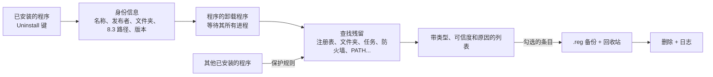

<div align="center">


# EXTIRPA

**EX**haustive **T**race & **I**nstalled-**R**esidue **P**urge **A**gent（**E.X.T.I.R.P.A.**）是一款 Windows 完整卸载工具。它先运行程序自带的卸载程序，再找出程序留下的一切：文件夹、文件、注册表项和值、服务、计划任务、防火墙规则、启动项、快捷方式、右键菜单项、文件类型以及 PATH 条目。从零用 C 语言编写，不依赖运行库，也不使用 C 标准库：只有一个约 240 KB 的可执行文件。

[English](../../README.md) · [Português (Brasil)](README.pt-BR.md) · [Español](README.es-ES.md) · [Français](README.fr-FR.md) · **中文** · [हिन्दी](README.hi-IN.md) · [العربية](README.ar.md) · [বাংলা](README.bn-BD.md)

   

</div>

---

## 为什么要用 EXTIRPA

程序自带的卸载程序通常只删除自己的文件就结束了。注册表里的设置、AppData 中的文件夹、检查更新的计划任务、防火墙规则、右键菜单项、加入 PATH 的文件夹，这些都会留下来，一个程序接一个程序地堆积。

EXTIRPA 先用程序自己的卸载程序正确地移除它，然后再寻找残留。它的目标是：

- **彻底：** 在程序通常会写入的所有位置查找，从 AppData 到计划任务和防火墙规则（完整列表见下文）。
- **安全：** 从不触碰属于 Windows 或其他已安装程序的内容；删除前备份注册表，文件送入回收站。
- **透明：** 每个条目都显示类型、可信度以及被找到的原因。只有高可信度的条目默认勾选。
- **轻量：** 一个约 240 KB 的原生可执行文件，无需安装，没有服务，没有遥测。完成工作后即关闭。
- **开源：** 代码完全可审查，你可以自行编译并按需修改。

## 名字的由来

**Extirpar**（葡萄牙语，“连根拔除”）意为把东西连根拔起，使其不再生长。这正是 EXTIRPA 对待程序的方式：不只移除看得见的部分，还要追查程序在系统中蔓延的“根”。

这个名字也是一个缩写：

- **EX**haustive（彻底）：搜索程序可能留下东西的每个位置，而不只是安装文件夹。
- **T**race（痕迹）：追踪程序的痕迹，即它写入注册表、任务、快捷方式和设置中的路径和名称；它也可以在安装进行时追踪安装过程。
- **I**nstalled-**R**esidue（安装残留）：目标是卸载程序完成后安装留下的东西。
- **P**urge **A**gent（清除代理）：清除这些残留，先备份注册表，并经由回收站删除。

首字母合起来就是：**E.X.T.I.R.P.A.**

## 功能

- **卸载：** 运行程序的卸载程序，并等待它及其启动的所有进程结束（job object），然后查找残留。
- **三种搜索模式：** 安全（精确名称和安装文件夹）、适中（还包括启动项、服务、快捷方式、计划任务、防火墙规则、文件类型以及一切指向程序文件夹的内容；推荐）、高级（还包括相似名称，以及对注册表中任何指向该程序的值的深度扫描）。
- **搜索位置：** 安装文件夹；Program Files、ProgramData、AppData（Roaming、Local、LocalLow）及发布者的文件夹；SOFTWARE 下的注册表项（64 位和 32 位，计算机和用户）；Run、RunOnce 及任务管理器的启动开关；服务；计划任务；Windows 防火墙规则；PATH 变量（系统和用户）；App Paths 和 SharedDLLs；文件类型（ProgID）、“打开方式”列表和默认关联；COM 组件和类型库；右键菜单项和资源管理器扩展（处理程序、图标覆盖、已批准的扩展）；Software\Clients 和 RegisteredApplications；桌面、开始菜单、启动文件夹中的快捷方式以及固定到任务栏的快捷方式；Windows 为每个程序保存的使用痕迹（MuiCache、兼容性设置）。以 8.3 短格式写入的路径（`C:\PROGRA~1\...`）也能识别。
- **快速卸载和批量卸载：** 选择多个程序并依次卸载。如果卸载程序支持，它会静默运行：自动识别 Windows Installer（MSI）、Inno Setup 和 NSIS，以及部分程序注册的 `QuietUninstallString`。
- **强制卸载：** 移除已被删除、已损坏或没有卸载程序的软件的残留。输入名称、文件夹或两者。
- **安装追踪：** 对注册表和文件夹拍摄快照，运行安装程序，再拍一次快照，并保存安装创建的内容。之后，“Uninstall using trace”会精确地移除这些内容。
- **猎人模式：** 窗口变成屏幕角落里的一个准星。把它拖到任何程序的窗口上，即可卸载该程序、打开其文件夹、结束它或禁止它随 Windows 启动。
- **Windows 应用：** 列出 Microsoft Store 应用和 Windows 自带应用，并可为当前用户或所有用户移除。
- **启动管理器：** 启用、禁用（与任务管理器相同的开关）或删除随 Windows 启动的项目，包括注册表和启动文件夹中的项目。
- **备份：** 每次删除注册表内容之前都会生成一个 `.reg` 文件，双击（或在 Backups 选项卡中）即可恢复；文件进入回收站；被移除的计划任务保存为 `.xml`；每次卸载前还可以创建 Windows 还原点。
- **全部记录：** 每次删除、失败和备份都写入 `%LOCALAPPDATA%\EXTIRPA\extirpa.log`。
- **界面为葡萄牙语（巴西）和英语**（其他 Windows 语言下显示英语），在任何缩放比例下都清晰（按显示器 DPI）。

## 快速上手

1. 从[最新版本](https://github.com/MatheusRFC/extirpa/releases/latest)下载 `extirpa.exe`，保存到任意位置，例如 `C:\Tools`。无需安装。
2. 运行它。Windows 会请求管理员权限（移除为所有用户安装的程序时需要），SmartScreen 会因为程序没有数字签名而发出警告：选择**更多信息 → 仍要运行**。
3. 选择一个程序并点击 **Uninstall**。选择搜索模式，确认，然后按照程序自己的卸载程序操作。
4. 完成后，EXTIRPA 会显示找到的残留。检查列表，取消勾选想保留的内容，然后点击 **Delete checked**。

EXTIRPA 不随 Windows 启动，没有后台服务，也不会留下任何运行中的进程：关闭即结束。它的数据（备份、追踪、日志和设置）位于 `%LOCALAPPDATA%\EXTIRPA`。

### 键盘

| 按键 | 操作 |
|---|---|
| `Ctrl+F` | 在当前列表中搜索 |
| `F5` | 刷新 |
| `Delete` / 双击 | 卸载所选程序 |
| `Esc` | 清除搜索 |

## 工作原理



1. 卸载之前，EXTIRPA 会读取所有能识别该程序的信息：去掉版本和架构后的名称、发布者、文件夹（也包括 8.3 短格式）以及可执行文件的名称。卸载程序运行后，程序的条目就会消失，所以必须先做这一步。
2. 运行卸载程序，并等待它及其启动的所有进程。
3. 查找残留。每个条目都有一个可信度：**高**（精确名称、程序自己的文件夹或指向其中的内容；默认勾选）、**中**（相似名称、间接引用；不勾选）或**低**（不确定；不勾选）。
4. 只删除你保持勾选的内容：先备份注册表，然后是服务和计划任务、防火墙规则和 PATH、注册表，最后经由回收站删除文件。正在使用的文件夹可以安排在下次重启时删除。

## 安全

删多了比删少了更糟，所以 EXTIRPA 围绕一系列保护系统其余部分的规则构建：

- **保护列表：** 系统文件夹（Windows、Program Files 本身、用户文件夹、AppData 本身、开始菜单……）以及属于 Windows 的注册表区域（`HKLM\SYSTEM`、Windows Installer 数据、策略、文件类型和 COM 的根……）永远不会被删除，包含它们的任何文件夹或键也不会。条目进入列表时会检查保护，删除前还会再检查一次。
- **最具体的文件夹优先：** `C:\Program Files\Vendor\Other` 内的路径属于安装在那里的程序，而不属于安装在 `C:\Program Files\Vendor` 的程序。
- **与另一个已安装程序共用的名称**（例如两个版本的 Python 共用 “Python”）默认不勾选，EXTIRPA 会深入其中，只找出属于要移除程序的部分。
- **包含另一个已安装程序的文件夹**会逐项删除，保留另一个程序。
- **Windows 自己的计划任务**（`\Microsoft\...`）永远不会被触碰。

详见 [SECURITY.md](../../SECURITY.md)。

## 从源代码构建

EXTIRPA 只需要 LLVM（clang、lld-link、llvm-rc 和 llvm-dlltool），可在 Windows 或 Linux 上构建。不需要 Windows SDK、MinGW 或 C 标准库：它使用的 Windows 声明位于 `src/win/win32.h`，为手写，并由 `tools/check_win32.py` 与 mingw-w64 官方头文件核对。

```bash
python3 tools/build.py test      # 测试：核心部分，以及在模拟注册表和磁盘上测试 Windows 部分
python3 tools/build.py           # build/extirpa.exe
python3 tools/build.py all       # 测试、extirpa.exe 和 extirpa-selftest.exe
python3 scripts/package.py       # 发布文件输出到 dist/
```

`extirpa-selftest.exe --selftest` 会在真实的 Windows 上运行自检，并把报告和截图保存到 `%LOCALAPPDATA%\EXTIRPA\selftest`。图标：`python3 tools/gerar_icones.py`（需要 Pillow）；原始图稿为 `assets/extirpa.svg`。

## 项目历史

参见 [CHANGELOG.md](../../CHANGELOG.md)。EXTIRPA 于 2026 年 10 月作为个人项目启动，是继 RAJADA、VISOR、ELMO 和 MIRA 之后的第五个项目，目的是拥有一个属于自己的卸载工具，而不必依赖第三方许可证。

## 许可证

EXTIRPA 是基于 [MIT 许可证](../../LICENSE)的自由软件。
